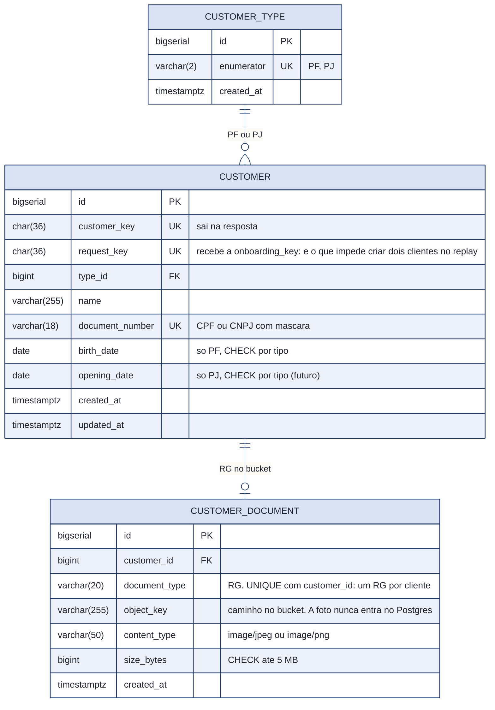
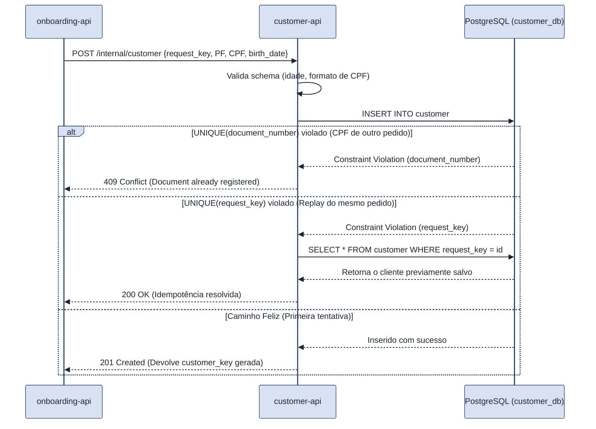

# RFC 01: customer-api, a dona do cadastro de clientes (MVP: Pessoa Física)

## Contextualização

### Entendendo o problema
A `customer-api` é o serviço central de identidade do banco. Ela é a única fonte de verdade para os dados cadastrais (PII - Personally Identificable Information) e metadados dos documentos de identificação (foto do RG). 

Neste momento, **o foco exclusivo da API é a Pessoa Física (PF)**. Embora a modelagem de banco de dados já possua as fundações para suportar Pessoa Jurídica (PJ) em atualizações futuras, todas as regras de negócio e validações atuais operam em torno do cliente PF.

Este serviço não sabe o que é uma conta bancária, uma transferência ou um processo de KYC. Seu único objetivo é registrar "Quem é essa pessoa?" e sustentar as seguintes garantias:
*   **Unicidade:** Um CPF só pode existir uma vez na base.
*   **Segurança e LGPD:** Os dados sensíveis ficam centralizados aqui. As outras APIs do banco (`account-api`, `transaction-api`) referenciam o cliente apenas pelo UUID (`customer_key`), sem nunca transitar nome ou CPF.
*   **Armazenamento Eficiente:** A API não guarda arquivos binários no banco de dados. Ela gerencia apenas o envio e a referência (`object_key`) do arquivo salvo em um Bucket S3 privado.
*   **Preparação para o Futuro (Future-proofing):** O modelo relacional já prevê a segregação de tipos (PF vs. PJ) para evitar refatorações estruturais massivas no futuro, mesmo que a API hoje só processe PFs.

### Explicando a solução de forma macro
A `customer-api` expõe rotas internas para que a `onboarding-api` (ou futuras integrações, como concessão de crédito) registre o cliente de forma isolada. Ela também expõe rotas para a consulta dos dados cadastrais do próprio cliente logado.

O banco de dados (`customer_db`) utiliza *Constraints* e *Checks* nativos para garantir a integridade logo na camada de dados. Para evitar cadastros duplicados devido a falhas de rede entre microsserviços, ela utiliza a chave de idempotência repassada pela origem (`request_key`).

**Alternativas descartadas:**
*   **Manter o cliente dentro da `account-api` ou `onboarding-api`:** Descartada porque o cliente tem um ciclo de vida independente. No futuro, o mesmo cliente PF poderá abrir uma segunda conta, atualizar seu endereço ou contratar um empréstimo sem precisar refazer o onboarding.
*   **Não modelar PJ no banco agora:** Descartada. Adicionar `CUSTOMER_TYPE` e `opening_date` posteriormente exigiria migrações complexas de esquema. Custou muito pouco adicionar a estrutura agora para garantir uma evolução suave no futuro.
*   **Salvar a imagem do RG no banco de dados (Base64/Blob):** Descartada por questões de performance. Salvar binários pesados degrada o tempo de resposta e incha os backups. Optou-se pelo armazenamento no S3 (emulado com LocalStack).

---

## Implementação

### Rotas Principais

| Método e Rota | O que faz | Entradas Principais | Saídas |
| :--- | :--- | :--- | :--- |
| `POST /internal/customer` | Cadastra um novo cliente (apenas PF no MVP). Rota idempotente. | `request_key` (chave do pedido externo), `name`, `document_number` (CPF), `birth_date`. | `201` cliente criado; `200` cliente já existente (idempotência); `409` conflito de CPF. |
| `GET /customer/{customer_key}` | Consulta os dados cadastrais. | `customer_key` no path, JWT válido do próprio cliente. | `200` sucesso; `404` cliente inexistente. |
| `POST /internal/customer/{customer_key}/document` | Salva o metadado do documento no banco após upload no S3. | `document_type`, `object_key`, `content_type`, `size_bytes`. | `201` documento registrado; `409` documento já enviado. |

### Contratos HTTP (Schemas e DTOs)

**`POST /internal/customer`**
Inicia a criação do cadastro isolado do cliente.
*   **Request Body:**
```json
{
  "request_key": "d290f1ee-6c54-4b01-90e6-d701748f0851", 
  "type": "PF",
  "name": "João da Silva",
  "document_number": "123.456.789-00",
  "birth_date": "1995-08-22"
}
```
*   **Response `201 Created` (ou `200 OK` por Idempotência):**
```json
{
  "customer_key": "a1b2c3d4-e5f6-7a8b-9c0d-1e2f3a4b5c6d",
  "type": "PF",
  "name": "João da Silva",
  "created_at": "2026-10-06T14:00:00Z"
}
```

**`POST /internal/customer/{customer_key}/document`**
Salva a referência da foto do RG enviada ao bucket.
*   **Request Body:**
```json
{
  "document_type": "RG",
  "side": "FRONT",
  "object_key": "rg-documentos/a1b2c3d4/front.jpg",
  "content_type": "image/jpeg",
  "size_bytes": 1048576
}
```

**`GET /customer/{customer_key}`**
Retorna o perfil do cliente ocultando dados parciais quando necessário.
*   **Response `200 OK`:**
```json
{
  "customer_key": "a1b2c3d4-e5f6-7a8b-9c0d-1e2f3a4b5c6d",
  "type": "PF",
  "name": "João da Silva",
  "document_number": "123.456.789-00",
  "birth_date": "1995-08-22",
  "created_at": "2026-10-06T14:00:00Z"
}
```

### Padronização de Erros (Responses 4xx)

**Exemplo de Erro 409 (Violação de Unicidade - CPF Existente)**
Quando uma requisição tenta cadastrar um CPF que já possui vínculo na base de dados, recusado via `UNIQUE INDEX` no banco.
```json
{
  "code": "CUS004009",
  "title": "Document Already Exists",
  "description": "The provided CPF is already registered to an existing customer.",
  "translation": "O CPF informado já está cadastrado em nossa base.",
  "request_id": "req_8f73b2a1",
  "errors": []
}
```

---

## Banco de Dados (Somente diagrama)



---

## Fluxos

**Criar Cliente (`POST /internal/customer`) — caminho feliz e proteção contra duplicidade**

O diagrama abaixo ilustra como o banco de dados atua como a última linha de defesa. Caso a `onboarding-api` sofra um timeout de rede e dispare o pedido duas vezes (mesmo CPF, mesma `request_key`), a `customer-api` garante a consistência e retorna sucesso contornando o erro de integridade.



---

## Principal desafio
*   **Qual é:** Centralizar a criação de Pessoas Físicas com proteção estrita contra a duplicidade de CPFs e problemas de concorrência originados por reenvios de chamadas internas (`retries`), além de estabelecer um modelo de dados resiliente ao futuro (PJ) sem vazar complexidade desnecessária para o momento atual.
*   **Por que é difícil:** Controllers na camada de aplicação muitas vezes falham em interceptar requisições concorrentes perfeitamente simultâneas (race conditions), gerando o risco de dois clientes nascerem com o mesmo documento. Além disso, modelar um banco apenas para PF agora e alterá-lo na marra depois (para suportar PJ) custaria alto *downtime* no futuro.
*   **Como o desenho resolve:** A responsabilidade foi transferida para restrições profundas do PostgreSQL. A unicidade é garantida pela `UNIQUE(document_number)`. A proteção contra falhas de rede (*retries*) é resolvida via `UNIQUE(request_key)`, que traduz a falha de banco em um `200 OK` assintomático. Para a arquitetura futura, a regra `CHECK ((birth_date IS NOT NULL) <> (opening_date IS NOT NULL))` já isola perfeitamente o comportamento de PF sem atrapalhar o lançamento da versão atual.

---

## Perguntas em aberto (Para discussão com o time)
1.  **Ciclo de Atualização de Documento:** Hoje garantimos `UNIQUE(customer_id, document_type)` na tabela `CUSTOMER_DOCUMENT` (ex: 1 RG por cliente). Se no futuro o cliente PF precisar atualizar a foto do RG por motivo de expiração ou má qualidade, permitiremos um `UPDATE` físico nessa linha do banco alterando a `object_key`, ou criaremos um registro de versão anulando o antigo?
2.  **Responsabilidade PII:** Embora não haja atualização cadastral para o MVP, a área de *Compliance* exige retenção de histórico. A `customer-api` deverá gerar eventos de mensageria (ex: `customer.updated`) contendo as mudanças do cadastro PF se passarmos a aceitar edição de endereço/nome, ou as áreas downstream sempre farão um `GET` via API?