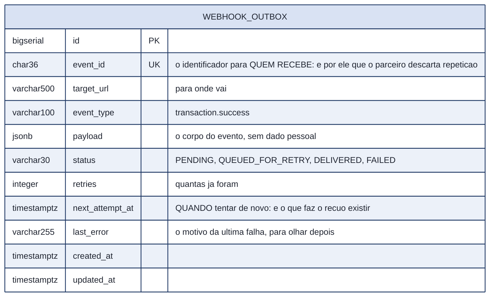
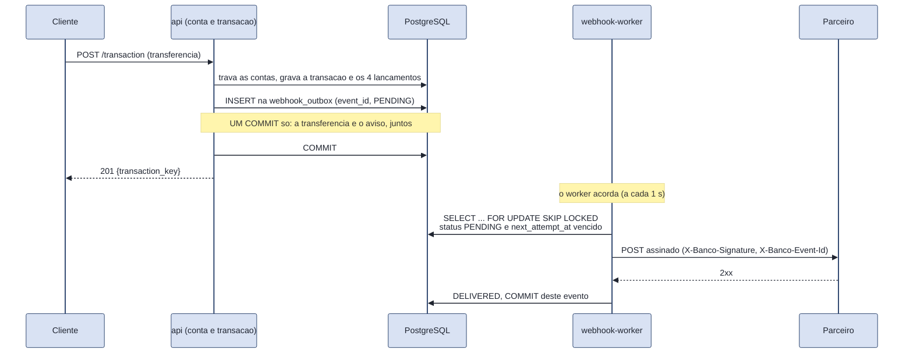
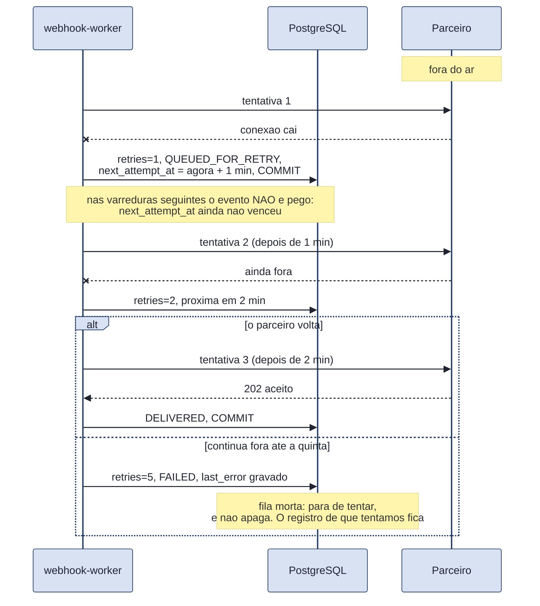

# RFC 06 - Webhooks de Saída (Outgoing) e Padrão Outbox

## 1. Contextualização e Objetivo
No nosso Banco Digital, precisamos notificar parceiros e clientes corporativos quando eventos importantes acontecem, como:
- Uma transação bancária falhou ou foi concluída com sucesso.
- O cadastro de uma nova conta foi aprovado ou mandado para revisão manual.

Em vez de forçar os clientes a ficarem consultando nossa API o tempo todo para saber se o status mudou (o que chamamos de *Polling* e que sobrecarrega nossos servidores), nós enviamos uma notificação ativamente para o sistema deles via uma requisição HTTP POST. Essa notificação é o **Webhook**.

A `webhook-api` será o microsserviço responsável exclusivamente por **disparar essas notificações para a internet**.

---

## 2. O Grande Desafio (E a Solução)

Sistemas financeiros não podem perder mensagens. Considere dois problemas graves:

1. **Problema Interno:** A API Principal aprova uma transação e tenta enviar um webhook, mas no exato milissegundo antes de enviar, o nosso servidor sofre um pico de energia e reinicia. A transação foi feita no banco de dados, mas o cliente nunca foi avisado.
2. **Problema Externo:** Nós tentamos avisar o cliente, mas o servidor dele está fora do ar naquele momento (Erro 503). O que fazemos? Desistimos? 

Para resolver isso de forma profissional, usaremos dois padrões de engenharia: o **Transactional Outbox Pattern** e **Filas com Exponential Backoff (Redis)**.

### 2.1. O que é o Transactional Outbox Pattern?
A regra de ouro é: **A ação e a intenção do aviso devem ser salvas juntas.**
Quando a `api` aprova uma transação, ela abre uma transação no banco de dados (PostgreSQL) e faz DUAS coisas antes de dar o `COMMIT`:
1. Altera o status da transação para `success`.
2. Insere uma linha em uma tabela chamada `webhook_outbox` (ex: `{"event": "transaction.success", "payload": {...}}`).

Como as duas ações ocorrem na mesma transação de banco de dados, é **impossível** que a transação mude de status sem que a mensagem vá para a "caixa de saída" (Outbox). Se faltar energia, o banco de dados desfaz tudo (Rollback) e o estado fica consistente.

### 2.1.1. A tabela, e o que cada coluna decide

Tres colunas carregam o desenho inteiro, e vale dizer o que cada uma impede:

- **`event_id`** existe porque a entrega por HTTP e "ao menos uma vez". Sem ele, o parceiro nao tem como saber que a segunda chegada e a mesma da primeira.
- **`next_attempt_at`** existe porque sem ela nao ha recuo: o worker reenviaria na varredura seguinte, e as cinco tentativas queimariam em segundos contra um parceiro que ainda esta fora.
- **Nao existe coluna de segredo.** O segredo do parceiro e configuracao, vem do ambiente, e uma coluna copiada em cada linha da fila seria um segredo a mais para vazar a cada evento.

### 2.2. Como o Exponential Backoff entra nisso?

A tabela `webhook_outbox` é passiva: alguém precisa ler dela e entregar. Esse alguém é o **`webhook-worker`**, um processo separado no `docker-compose.yml`, igual ao `onboarding-worker`. Ele acorda a cada segundo, pega o que está na hora de entregar, assina, manda, e volta a dormir.

**O fluxo funciona assim:**
1. O `webhook-worker` procura na `webhook_outbox` o que está `PENDING` ou `QUEUED_FOR_RETRY` **e com `next_attempt_at` já vencido**.
2. Trava as linhas com `FOR UPDATE SKIP LOCKED`, para que duas réplicas do worker nunca peguem o mesmo evento nem fiquem esperando uma pela outra.
3. Faz o `POST` para o parceiro, assinado, e grava o resultado. **Um `COMMIT` por evento**: com um commit só no fim do lote, o processo morrer no meio faria o lote inteiro voltar para `PENDING`, inclusive o que já tinha chegado ao parceiro.

**Sobre o Redis, e por que ele não aparece aqui.** A versão anterior desta RFC propunha o Redis como gerenciador de fila, com Celery ou RQ. **Descartado**, e o motivo é que a fila já existe: é a própria `webhook_outbox`, que precisa existir de qualquer jeito por causa do Outbox. Pôr o Redis no meio acrescenta uma peça que pode cair, um estado que pode divergir do banco, e uma dependência nova, sem resolver nada que a tabela não resolva. O `next_attempt_at` é uma coluna com índice, e o Postgres sabe ordenar por ela.

**Ganharia se** a vazão passasse de alguns milhares de eventos por segundo, quando varrer uma tabela a cada segundo custaria mais que empurrar numa fila em memória. Não é o nosso caso, e quando for, a tabela continua sendo a fonte da verdade: o Redis entraria na frente dela, não no lugar dela.

**E se o servidor do cliente der erro (Exponential Backoff)?**
Se o cliente estiver fora do ar, nada se perde: o evento continua na tabela, com a hora da próxima tentativa na coluna `next_attempt_at`. A fórmula é `base * 2^(tentativas - 1)`, e a base vem do ambiente. Em produção ela é de 60 segundos, e a sequência fica:
- Falhou a 1ª vez? Tenta de novo em **1 minuto**.
- Falhou a 2ª vez? Tenta de novo em **2 minutos**.
- Falhou a 3ª vez? Tenta de novo em **4 minutos**.
- Falhou a 4ª vez? Tenta de novo em **8 minutos**.

Depois de **5 tentativas** o evento vira `FAILED` e para de ser tentado. Ele não é apagado: a fila morta é o registro de que tentamos, com o último erro gravado em `last_error`.

**No `docker-compose.yml` a base é 2 segundos, não 60.** O ambiente local e os testes não podem levar minutos para provar uma retentativa. O valor está no compose, visível, e não escondido no código.

**A entrega é "ao menos uma vez", e não "exatamente uma vez".** Se o parceiro responder e o nosso `COMMIT` falhar logo depois, o mesmo evento sai de novo. Prometer o contrário numa entrega por HTTP seria mentira. Por isso todo evento leva um **`event_id` próprio**, no corpo e no cabeçalho `X-Banco-Event-Id`: **é quem recebe que descarta a repetição**, e é assim que os webhooks da própria QI Tech funcionam.

**Qualquer `2xx` é sucesso.** Um parceiro que responde `201`, `202` ou `204` está aceitando o evento. Tratar só o `200` como sucesso faria o mesmo evento ser entregue cinco vezes e depois dado como perdido, contra um parceiro que nunca errou.

---

## 3. Segurança e Contratos

### 3.1. Assinatura Criptográfica (HMAC)
Como o cliente vai saber que aquele Webhook (um simples POST recebido na internet) realmente veio do nosso Banco e não de um hacker fingindo ser nós?

Todo webhook que a nossa `webhook-api` disparar conterá um **Header de Assinatura** (Exemplo: `X-Banco-Signature`). 
A nossa API pega o corpo exato que está sendo enviado, byte a byte, e aplica HMAC-SHA256 com uma **chave secreta** que só o nosso banco e aquele parceiro conhecem. O parceiro faz a mesma conta do lado dele; se baterem, ele tem certeza de que fomos nós.

Tem de ser o corpo **exato**: se o worker assinar um JSON e mandar outro, com os campos em outra ordem, a conta do parceiro não fecha e ele recusa um evento legítimo.

**O segredo não mora no banco.** Ele é configuração, vem da variável de ambiente `WEBHOOK_SECRET`, e nenhuma linha da fila carrega cópia dele. Uma coluna de segredo em texto puro, copiada em cada evento, seria um segredo a mais para vazar a cada evento, e o 12-factor é explícito: config fora do código, e nunca no repositório.

### 3.2. Os eventos

| Evento | Quem publica | Existe hoje? |
|---|---|---|
| `transaction.success` | o `transaction_controller`, no mesmo `COMMIT` da transação | **sim** |
| `account.blocked`, `account.closed` | o `account_controller` | não: a rota existe, falta publicar |
| `onboarding.*` | o `onboarding-worker`, pela própria caixa de saída dele | sim, mas entregue por outro caminho (ver 5) |

Esta tabela diz o que **está no código**, e não o que seria bom ter. Uma RFC que lista cinco eventos quando um existe é uma RFC que a banca confere e não encontra.

---

## 4. O Fluxo Completo Resumido

1. A `api` aprova a transação.
2. No **mesmo `COMMIT`**, ela grava a transação, os lançamentos e uma linha em `webhook_outbox`, com um `event_id` próprio. Ou as três coisas acontecem, ou nenhuma.
3. O `webhook-worker` acorda, procura o que está `PENDING` ou `QUEUED_FOR_RETRY` com `next_attempt_at` vencido, e trava as linhas com `FOR UPDATE SKIP LOCKED`.
4. Assina o corpo exato com HMAC-SHA256 e envia por `POST`, com `X-Banco-Signature` e `X-Banco-Event-Id`.
5. Respondeu qualquer `2xx`? Vira `DELIVERED`, e o `COMMIT` é desse evento só.
6. Deu erro, ou a conexão caiu? Conta a tentativa, grava o motivo em `last_error` e agenda a próxima em `next_attempt_at`, com recuo exponencial. Na quinta, vira `FAILED` e para.

---

### 4.1. O caminho feliz, e onde o `COMMIT` cai

**O que nao acontece:** a api **nao** chama o parceiro. Ela so grava. Se chamasse antes do `COMMIT` e o commit falhasse, o parceiro saberia de uma transferencia que nao existe; se chamasse depois, e o processo morresse no meio, a transferencia existiria sem ninguem avisado e **sem registro de que faltou avisar**. Gravando junto, o pior caso e o parceiro receber duas vezes, e para isso existe o `event_id`.

**O `COMMIT` do worker e por evento, nao por lote.** Com um commit no fim do lote, o processo morrer no meio devolveria o lote inteiro para `PENDING`, inclusive o que ja tinha chegado ao parceiro.

### 4.2. O parceiro fora do ar, e o recuo

A sequencia e 1, 2, 4, 8 e 16 minutos, de `base * 2^(tentativas - 1)` com a base de 60 segundos. **No `docker-compose.yml` a base e 2 segundos**, para o ambiente local e os testes nao levarem minutos: o valor esta la, visivel, e nao escondido no codigo.

**Por que recuar, e nao insistir.** O parceiro ja esta com problema. Repetir a cada segundo acrescenta carga a quem menos pode receber, e e o que a AWS chama de retentativa egoista. O recuo da tempo de ele se recuperar.

### 4.3. O que ainda nao e feito aqui: jitter

Todos os eventos que falharam na mesma janela voltam **no mesmo instante**, porque o recuo e calculado do mesmo jeito para todos. Com um parceiro so e poucos eventos isto nao aparece; com muitos, as retentativas chegam em onda, exatamente quando o parceiro esta voltando. A correcao e barata e conhecida: somar um valor aleatorio ao `next_attempt_at` (jitter). **Nao esta feito**, e fica registrado aqui em vez de ficar implicito.

## 5. O que esta versão **não** resolve

Três limites conhecidos, escritos aqui porque uma RFC que promete o que o código não faz é pior que uma RFC curta.

**Um parceiro só, configurado por ambiente.** `WEBHOOK_TARGET_URL` e `WEBHOOK_SECRET` valem para todo evento. O desenho certo é uma tabela de assinaturas: cada parceiro com a própria URL, o próprio segredo e a própria lista de eventos que assina. **Descartado por escopo**, e ganharia no primeiro dia em que existir um segundo parceiro.

**A entrada da webhook-api não existe.** O `onboarding-worker` entrega os eventos dele por HTTP para `WEBHOOK_API_URL`, que no `docker-compose.yml` aponta para o Mockserver. São duas metades que ainda não se encontraram: a de saída, que esta RFC descreve e que funciona, e a de entrada, uma rota `POST /internal/event` que receberia os eventos das outras APIs e os gravaria na mesma `webhook_outbox`. A conta e a transação não precisam dessa rota, porque compartilham o banco e gravam direto na caixa de saída, no mesmo `COMMIT`, que é mais seguro que um salto HTTP.

**Sem ordem garantida entre eventos.** Dois eventos da mesma conta podem chegar fora de ordem se o primeiro falhar e o segundo não. O parceiro que precisar de ordem usa o `created_at` do corpo. Garantir ordem exigiria entregar em série por parceiro, e o preço é um parceiro lento segurar a fila de todos.
