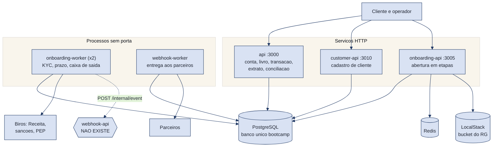
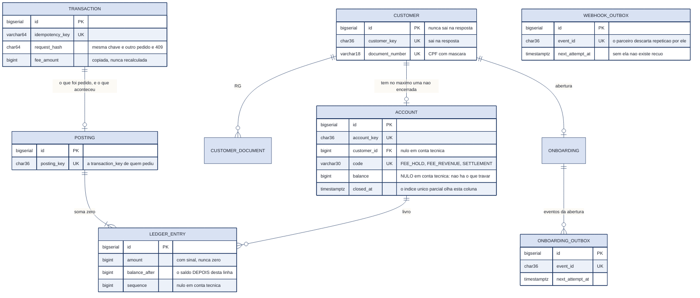
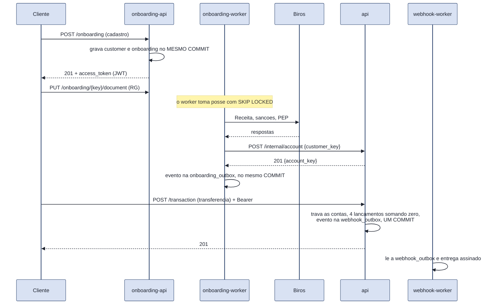

# RFC 00: o ecossistema, e como as peças se encaixam

| | |
|---|---|
| **Time** | Carlos, Eduardo e Enrico |
| **Data** | 10/10/2026 |
| **Versão** | 1.0 |

Esta RFC descreve **o que existe no repositório**, não o que seria bom existir. Onde uma decisão foi tomada e não implementada, está dito. Onde duas partes do sistema discordam entre si, está dito também: uma RFC que esconde a costura é pior que uma RFC curta.

## Contextualização

### Entendendo o problema

Um banco digital não é uma aplicação só. Abrir conta, guardar o cadastro, mover dinheiro e avisar parceiros são quatro responsabilidades com ritmos diferentes: a abertura espera birôs externos e pode levar minutos, a transferência precisa terminar em milissegundos, e o aviso ao parceiro pode esperar mas não pode se perder.

Partir isso em serviços resolve o ritmo e cria três problemas novos:

1. **Onde o dinheiro mora.** Se mais de um serviço escreve saldo, duas somas corretas em lugares diferentes dão um total errado.
2. **O que acontece no meio.** Entre "gravei aqui" e "avisei o outro" cabe uma queda de energia. O estado pela metade é o modo de falha mais caro que existe num banco.
3. **Quem pode pedir o quê.** Um serviço que confia em quem o chama só porque a chamada veio de dentro da rede é um serviço que confia em qualquer coisa que entre na rede.

O que o sistema **garante**: o saldo nunca fica negativo, nada é cobrado duas vezes, nada fica pela metade, e a soma de todos os lançamentos de todas as contas fecha em zero. O que ele **não garante** está na última seção.

Fora do escopo: caixinha que rende, saque, cartão, Pix, e o gateway (ver alternativas descartadas).

### Explicando a solução de forma macro

**A regra que define o desenho: só a `api` altera saldo.** Ela é a dona de `account`, `posting` e `ledger_entry`, e é a única que escreve nelas. As outras não pedem dinheiro emprestado nem calculam saldo: quem precisa de uma conta chama `POST /internal/account` e recebe a chave.

**Um banco de dados só, com dono por tabela.** O `database/database.sql` tem seções numeradas, uma por domínio, e cada tabela tem um serviço que escreve nela. Como é um banco só, as referências entre domínios são `FOREIGN KEY` de verdade: `account.customer_id` aponta para `customer.id`, e o banco recusa um órfão sozinho.

**O que atravessa a fronteira atravessa gravado.** Nenhum serviço faz uma chamada HTTP contando que ela vai dar certo: ele grava a intenção na mesma transação da mudança de estado, e um worker entrega depois. É o padrão Outbox, e ele aparece duas vezes: na abertura de conta (`onboarding_outbox`) e no aviso a parceiros (`webhook_outbox`).

#### Alternativas descartadas

**Cinco bancos, um por serviço.** Era o desenho da v0.2, e foi abandonado em 06/10. Custava caro: sem `FOREIGN KEY` entre domínios, nada impede uma conta apontar para um cliente que não existe, e a conferência vira código em vez de restrição. Além disso, cadastrar o cliente e abrir a conta deixaria de caber num `COMMIT`. **Ganharia se** os serviços precisassem escalar ou falhar de forma independente, que é o primeiro dia em que um deles tiver tráfego de verdade: aí um banco compartilhado vira o ponto único de falha de todos.

**Um gateway nginx na porta 3000.** Era o desenho da v0.2: porta única, roteando por prefixo e **bloqueando `/internal/...` vindo de fora**. **Não foi construído**, e o preço é concreto, não teórico: hoje os três serviços publicam portas direto na máquina, e `POST /internal/posting`, a rota que move dinheiro, responde de fora. Conferido: sem o `INTERNAL-TOKEN` ela devolve `403`, com o token ela processa. **A única coisa entre a internet e o livro de lançamentos é esse token.** Num ambiente de verdade, o gateway é o primeiro item da lista. **Ganharia agora** se o projeto fosse exposto a qualquer rede que não seja a máquina do avaliador.

**Pedir o posting por HTTP, de um serviço para outro.** Era o desenho da v0.2: a transaction-api gravaria `PENDING`, chamaria a account-api e trataria o timeout. Descartado quando o cliente e a conta passaram a dividir o banco: a transação e os lançamentos passaram a caber no mesmo `COMMIT`, e um salto HTTP no meio só acrescentaria um modo de falha. **Ganharia se** a conta e a transação fossem serviços separados de verdade, com bancos separados, que é o cenário da primeira alternativa.

**Não fazer nada: um serviço único.** Era a v0.1, e é a opção mais barata. Tudo num `COMMIT`, nenhuma fronteira, nenhum worker. **Ganharia se** o projeto parasse na conta e na transferência. Perdeu porque a abertura de conta espera três birôs externos e um upload: num serviço só, isso prende uma requisição HTTP por minutos, ou vira um `thread` solto sem registro do que ficou pela metade.

## Implementação

### Rotas: o contrato entre as peças

As rotas de cliente estão na RFC 01, as de conta e transação na RFC 02, as de abertura na RFC 05 e as de webhook na RFC 06. O que interessa aqui são as **quatro travessias de fronteira** que existem de verdade:

| Quem chama | Quem responde | Contrato | Quando | O que garante |
|---|---|---|---|---|
| `onboarding-worker` | `api` | `POST /internal/account` com `customer_key` | depois de `APPROVED` | `201` conta nova ou `200` a que já existia. O índice único parcial garante no máximo uma conta não encerrada por cliente, então repetir não cria duas |
| `onboarding-worker` | birôs (Mockserver) | `POST /receita`, `/sancoes`, `/pep`, timeout 2 s, circuit breaker | na análise | Nenhuma aprovação sem as três respostas |
| `onboarding-worker` | **webhook-api** | `POST /internal/event` | cada evento da caixa de saída | **O serviço não existe.** No compose o destino é o Mockserver. Ver a última seção |
| `webhook-worker` | parceiros | `POST` assinado em HMAC-SHA256, com `event_id` | cada evento da `webhook_outbox` | Entrega ao menos uma vez; quem recebe descarta repetição pelo `event_id` |

**As rotas `/internal/...` são chamadas por outro serviço, nunca por um cliente.** Elas não passam por gateway nenhum, porque não há gateway: o que as separa do mundo é o `INTERNAL-TOKEN`.

#### Autenticação: três camadas, três perguntas

| Camada | Cabeçalho | A pergunta que responde | Recusa |
|---|---|---|---|
| aplicação | `INTERNAL-TOKEN` | é um cliente nosso que está chamando? | `403 QIT000002` |
| identidade | `Authorization: Bearer` | **quem** está chamando? | `401 QIT000003`, `QIT000004`, `QIT000005` |
| operação | o escopo da credencial | ele pode pedir **isto**? | `403 QIT000006` |

A credencial é um JWT assinado em HS256 com a `AUTH_SECRET`, com `sub` igual à `customer_key`. **Quem emite é a onboarding-api**, no fim da abertura; **cada serviço confere sozinho**, sem chamar ninguém e sem ir ao banco, porque a assinatura já prova que ela saiu de dentro. Dois escopos: `onboarding` é o cliente e vê só a própria conta; `operator` lê qualquer conta, deposita e muda estado de conta.

Confundir as duas primeiras camadas é a causa mais comum dos itens de autorização quebrada do OWASP. O `INTERNAL-TOKEN` diz **que aplicação** fala, não **quem**: sem a segunda camada, qualquer um que tenha o token lê o saldo de qualquer conta.

### Banco de Dados

**Quem escreve cada tabela**, que é a regra que mantém um banco compartilhado honesto:

| Serviço | Escreve |
|---|---|
| `api` | `account`, `account_status_event`, `posting`, `ledger_entry`, `transaction`, `fee_policy`, `webhook_outbox` |
| `customer-api` | `customer`, `customer_document` |
| `onboarding-api` e worker | `onboarding`, `onboarding_check`, `onboarding_document`, `onboarding_status_event`, `onboarding_outbox`, **e `customer`** |
| `webhook-worker` | `webhook_outbox` (só o estado da entrega) |

**A `api` lê `customer` e não escreve.** Ela precisa do `customer_id` porque a `FOREIGN KEY` é de verdade; a leitura é por `customer_key` e nada mais.

> **Principal desafio: duas coisas que têm de acontecer juntas, em lugares que falham separado.**
>
> **Qual é.** Mover dinheiro, mudar o estado de uma abertura e avisar quem está de fora são três escritas em três ritmos. A transferência tem de terminar agora; o aviso ao parceiro pode esperar, mas não pode se perder; e entre uma coisa e outra cabe uma queda.
>
> **Por que é difícil.** As duas saídas óbvias estão erradas pelos motivos opostos. Chamar o parceiro **antes** do `COMMIT` avisa de uma transferência que pode não existir. Chamar **depois** perde o aviso se o processo morrer no meio, e não deixa registro de que faltou avisar. Nenhum `try/except` conserta isso: o problema é que são dois sistemas, e não há transação que cubra os dois.
>
> **Como o desenho resolve.** O aviso vira **uma linha na mesma transação do banco**: `INSERT` na caixa de saída junto com o `UPDATE` do saldo, um `COMMIT` só. Ou as duas coisas acontecem, ou nenhuma. Um worker separado lê a caixa, entrega, e marca. O preço é que a entrega passa a ser "ao menos uma vez", e por isso todo evento carrega um `event_id` próprio: **quem recebe descarta a repetição**. Dentro do banco, o mesmo princípio vale com `UNIQUE`: a `posting_key` e a `idempotency_key` fazem o replay devolver o original em vez de duplicar.

### Fluxos

#### Da abertura à primeira transferência

**Nenhuma trava de banco fica aberta durante uma chamada HTTP.** O worker toma posse da abertura com `FOR UPDATE SKIP LOCKED` e **libera** antes de falar com os birôs, marcando um prazo de posse. Sem isso, três consultas externas de dois segundos cada segurariam a linha por seis segundos, e duas réplicas do worker fariam fila.

#### O que cai quando cada peça cai

| Peça | O que para | O que continua |
|---|---|---|
| `db` | tudo | nada. É o ponto único de falha aceito |
| `redis` | nada para | os limites por origem desligam sozinhos por 30 s e a abertura continua. Ele guarda só o que é pequeno e reconstruível: **nunca saldo, nunca estado de conta** |
| `localstack` | o envio do RG | a abertura fica na etapa, sem perder o que já foi feito |
| birôs | a análise | a abertura espera; o circuit breaker abre depois de 5 falhas e para de insistir |
| `onboarding-worker` | a análise e a entrega dos eventos | as três APIs respondem normalmente. O que estava na fila continua lá |
| `webhook-worker` | a entrega aos parceiros | **nada se perde**: o que não foi entregue fica na tabela com a hora da próxima tentativa |
| `api` | mover dinheiro | a abertura chega até a análise e para antes de criar a conta |

#### A prova de que o dinheiro fecha

`GET /internal/reconciliation` soma **todos** os lançamentos de **todas** as contas, inclusive as técnicas, e tem de dar **zero**. É o único teste que olha o sistema inteiro de uma vez: se der qualquer outro número, algum centavo foi criado ou destruído sem contrapartida.

As três contas técnicas são a contrapartida que faz a soma fechar: `SETTLEMENT` (depósitos), `FEE_HOLD` (tarifa a apropriar) e `FEE_REVENUE` (receita depois do prazo). **Elas não têm coluna `balance`**, de propósito: sem linha de saldo não há o que travar, e a conta de tarifa deixa de serializar toda transferência do sistema.

## O que este desenho não resolve

Escrito aqui porque a R7 cobra o preço das decisões, e porque um avaliador que abre o `docker-compose.yml` encontra isto em dois minutos.

1. **Não há gateway.** As portas dos três serviços estão publicadas na máquina, e `/internal/...` responde de fora. O `INTERNAL-TOKEN` é a única barreira, e o valor padrão do `.env.example` é de estudo.
2. **A entrada da webhook-api não existe.** O `onboarding-worker` entrega os eventos dele por `POST /internal/event`, e no compose esse endereço é o Mockserver. A metade de **saída** funciona (RFC 06); falta a rota que junta as duas, gravando na mesma `webhook_outbox` o que chega por HTTP. São **duas caixas de saída** onde deveria haver uma.
3. **Dois serviços escrevem `customer`:** a `customer-api` e a `onboarding-api`. A tabela tem `UNIQUE` no documento, então o banco impede o duplicado, mas quem é a fonte da verdade da `customer_key` não está decidido.
4. **Duas convenções de código de erro:** `QIT` na `api` e na `customer-api`, `ONB` na `onboarding-api`. O da casa é `QIT`. O custo de unificar é um *find and replace* mais o catálogo da RFC 05; o de não unificar é a banca abrir um repositório e ver duas convenções.
5. **A tarifa nunca é apropriada.** O valor entra em `FEE_HOLD` e fica. A conta `FEE_REVENUE` existe e nunca recebe nada, porque o prazo de 7 dias é escolha do time e não foi confirmado (RFC 02, pergunta em aberto 1).
6. **Sem métrica e sem trace.** Há log estruturado com `request_id` costurando a requisição inteira, que é o sinal que cabe na aplicação. Métrica e trace vêm da infraestrutura, e não há infraestrutura aqui.
7. **O `/health_check` responde liveness, não readiness.** Ele de propósito não toca no banco: diz que o processo está vivo, não que está pronto para receber tráfego. Um balanceador precisaria da segunda pergunta.
