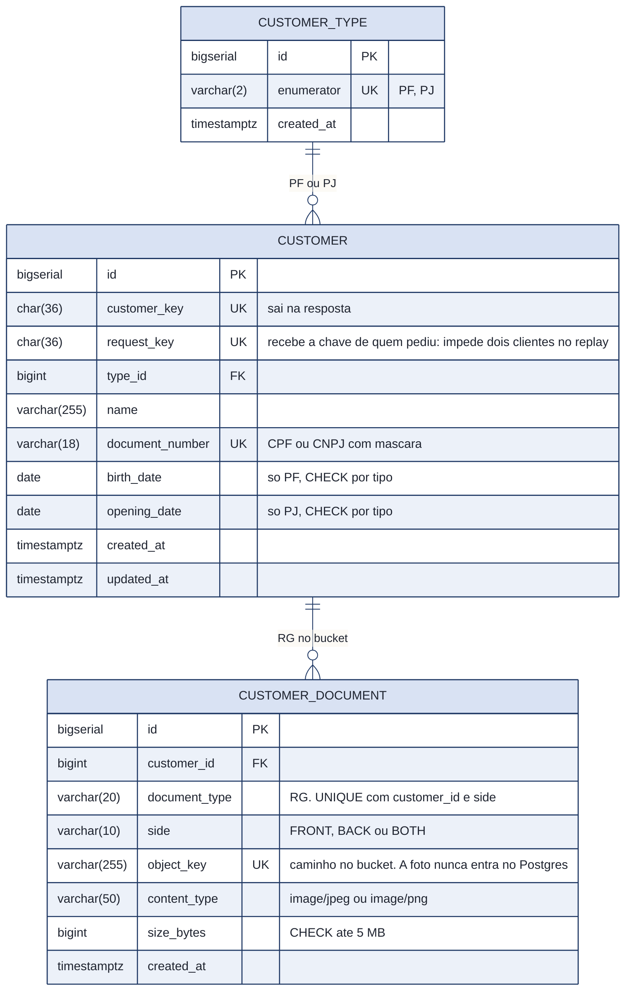
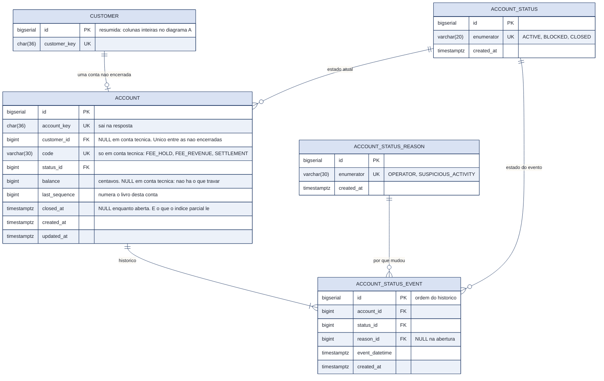
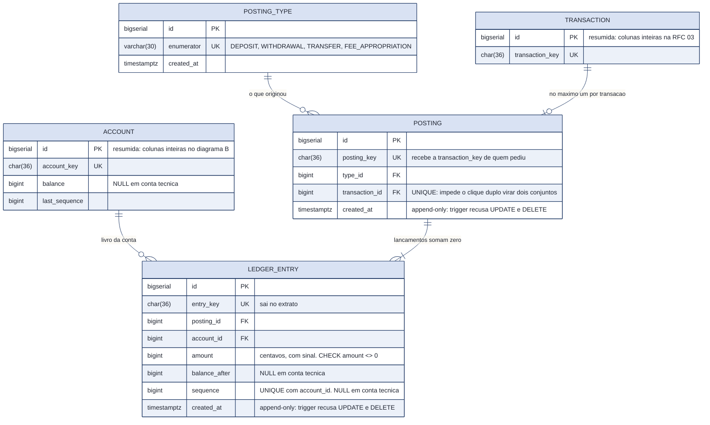
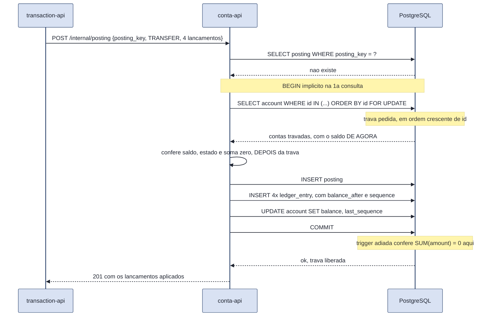
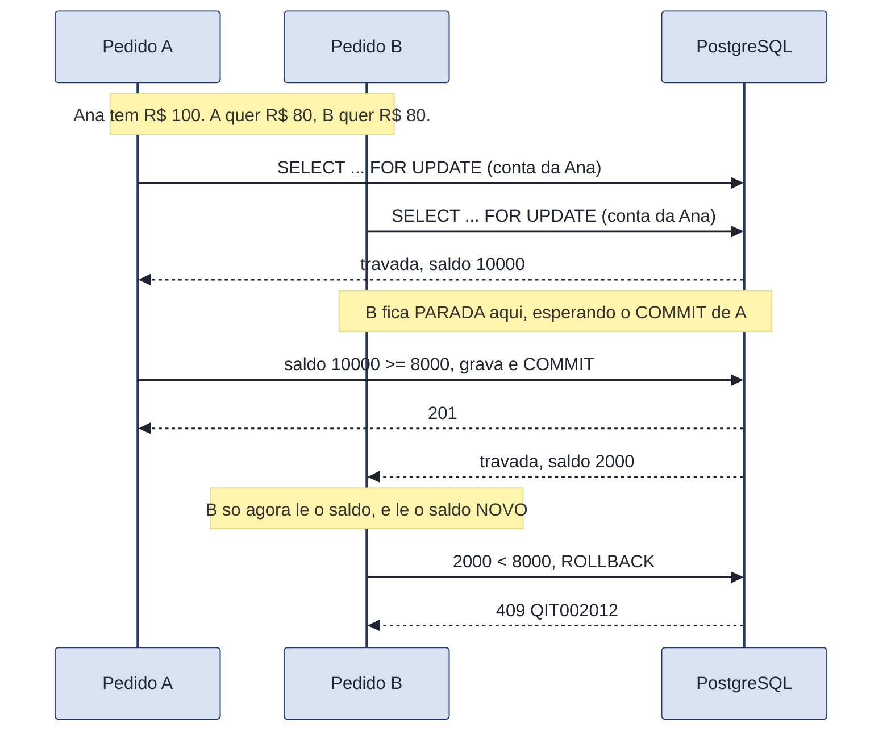
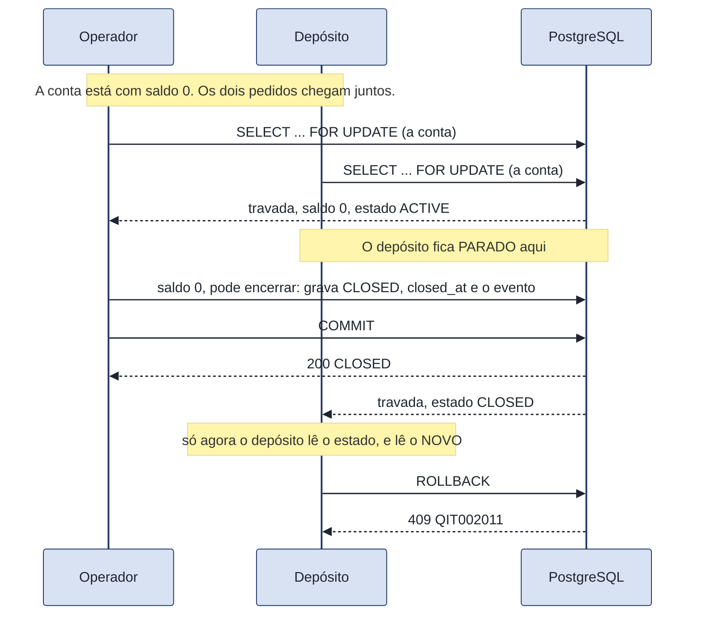
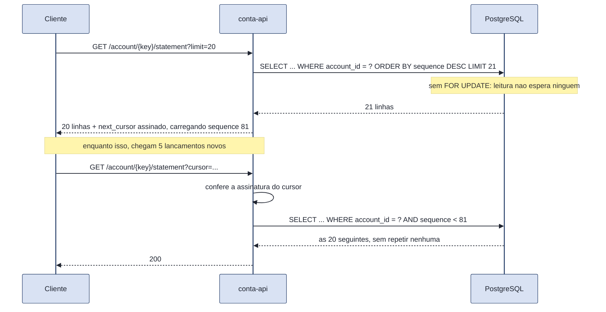

# RFC 02: a API de conta e transação, onde o dinheiro mora

| | |
|---|---|
| **Time** | Enrico Martim Zucollo · Carlos Alberto Magalhães Neto · Eduardo Lopes Valério |
| **Data** | 06/10/2026 |
| **Versão** | 1.0 (absorve a RFC 01; chaves internas viram FOREIGN KEY; contas técnicas sem saldo) |

---

## Contextualização

### Entendendo o problema

Este serviço responde duas perguntas e guarda uma coisa só: quem é a pessoa, qual é a conta dela, e quanto dinheiro existe nela. Ele é o único lugar do sistema que altera saldo. A API de transações decide a regra, a de criação de conta decide quem entra, e as duas **pedem** a este serviço que o dinheiro se mova. Nenhuma outra escreve um centavo.

As operações são: cadastrar o cliente, abrir a conta dele, consultar saldo, listar o extrato, mudar o estado da conta, e aplicar um conjunto de lançamentos pedido por quem está do lado de fora.

Sobre o dinheiro, o serviço sustenta cinco garantias:

- **O saldo nunca fica negativo.** Se falhar, o banco empresta dinheiro sem ter decidido emprestar.
- **Nada acontece duas vezes.** Dois cliques, ou uma rede que caiu e repetiu o pedido, produzem um efeito só. Se falhar, o cliente é cobrado em dobro.
- **Nada fica pela metade.** Ou os dois lados de uma transferência acontecem, ou nenhum. Se falhar, sai dinheiro de uma conta e não entra em nenhuma.
- **O extrato prova o saldo.** Cada linha do extrato traz o saldo que ficou depois dela, e a última bate com o saldo atual. Se falhar, o cliente vê um número que ninguém consegue explicar.
- **A soma de tudo é zero.** Somando todos os lançamentos de todas as contas, de clientes e do próprio banco, o resultado é zero. Se falhar, existe dinheiro no sistema que não veio de lugar nenhum.

**Fora do escopo:** investimento, abertura de conta em etapas com análise de documento, mais de uma conta por cliente, cliente pessoa jurídica, encerramento com transferência de saldo remanescente, e qualquer canal que não seja API.

### Explicando a solução de forma macro

O saldo mora em dois lugares ao mesmo tempo, e isso é a decisão central. Existe uma coluna `balance` na conta, que é barata de ler, e existe uma tabela de lançamentos, o livro, que é a verdade histórica e nunca é editada. As duas são escritas no mesmo `COMMIT`. A coluna responde "quanto tem agora" em uma linha; o livro responde "por quê" e permite reconstruir o saldo do zero.

Toda movimentação é um **posting**: um conjunto de lançamentos que soma zero, aplicado numa transação ACID única. Uma transferência de R$ 100 com R$ 2 de tarifa gera quatro lançamentos: menos 10.000 e menos 200 centavos na origem, mais 10.000 no destino, mais 200 numa conta técnica do próprio banco. A soma é zero por construção, e o banco recusa o `COMMIT` se não for.

As contas envolvidas são travadas com `SELECT ... FOR UPDATE` sempre em ordem crescente de `id`, nunca na ordem em que os parâmetros chegaram. É o que impede duas transferências cruzadas, A para B e B para A ao mesmo tempo, de travarem uma na outra.

As contas técnicas do banco, que recebem a tarifa e fazem a contrapartida dos depósitos, **não têm coluna de saldo**. O saldo delas é a soma do livro. Isso não é economia de espaço: é o que impede que toda transferência do sistema dispute a mesma linha.

**Alternativas descartadas, sobre onde o saldo mora:**

- **Só a coluna de saldo, sem livro.** Descartada porque o extrato deixaria de provar o saldo e uma divergência nunca mais seria explicável: não haveria como saber qual operação errou. Ganharia num sistema onde o histórico não importa e o volume de escrita é o gargalo, porque é uma linha atualizada em vez de várias inseridas.

- **Só o livro, com o saldo sempre somado na hora.** Descartada porque consultar saldo passaria a custar uma soma sobre todo o histórico da conta, e a checagem de saldo acontece dentro da trava, no caminho crítico de toda transferência. Ganharia se as contas tivessem poucos lançamentos, ou com uma tabela de saldos consolidados por período, que é complexidade que não cabe aqui.

- **Deixar o banco decidir, sem trava: `UPDATE account SET balance = balance - :v WHERE id = :id AND balance >= :v`.** Zero linhas afetadas significa saldo insuficiente, numa ida só ao banco e sem fila. É a alternativa mais forte contra este desenho, e o próprio Haki Benita recomenda evitar trava quando dá. Descartada porque uma transferência mexe em duas contas, três ou quatro lançamentos e o cabeçalho, e o `balance_after` de cada lançamento precisa ser lido depois do débito e antes do próximo: é uma sequência de decisões, não um `UPDATE` atômico. E porque empurraria a regra de negócio para dentro do SQL, ou seja, para dentro do repository, que por convenção do projeto não decide nada. **Ganharia se a operação fosse um débito simples numa conta só, sob contenção alta.** Aí é melhor que trava, sem discussão.

- **Contas técnicas com coluna de saldo, como qualquer outra.** Descartada porque a conta de tarifa entra em toda transferência: travá-la faria o sistema inteiro atender uma transferência por vez, e subir mais réplicas deixaria de significar qualquer coisa. Sem a coluna, o lançamento nela é um `INSERT` puro, que não lê nada da linha da conta. Ganharia se alguém precisasse consultar o saldo técnico em tempo real, o que ninguém precisa: ele é relatório, e sai de uma soma.

**Alternativas descartadas, sobre o cadastro e os limites deste serviço:**

- **Absorver o cliente dentro da API de criação de conta, como propõe a RFC 05 v0.5.** Descartada porque o cliente tem ciclo de vida independente da abertura: a mesma pessoa pode, no futuro, abrir uma segunda conta, atualizar o endereço ou contratar um empréstimo sem refazer o onboarding. O cadastro ficaria preso a um processo que acontece uma vez na vida. Ganharia no escopo de hoje, em que a abertura é a única jornada que existe e cada fronteira entre serviços é um ponto de falha a mais, com CPF e renda transitando entre APIs.

- **Não separar cliente de conta, e guardar o saldo na própria linha do cliente.** Descartada porque as contas técnicas do banco não têm dono: a conta de tarifa e a de liquidação precisariam de um nome e de um CPF inventados, e o livro precisa apontar para conta, não para pessoa. Ganharia se o banco não tivesse contas próprias e cada cliente tivesse exatamente uma conta para sempre.

- **Não modelar pessoa jurídica agora, só pessoa física.** Descartada porque acrescentar `customer_type` e `opening_date` depois exigiria migração de schema com o sistema já em produção, e custou muito pouco deixar a estrutura pronta agora. As regras de negócio continuam só de pessoa física: o que existe hoje é a estrutura, não o comportamento. Ganharia se a chance de aceitar pessoa jurídica fosse remota, porque aí seriam duas colunas nulas carregadas para sempre sem uso.

- **Guardar a imagem do RG no próprio banco, em Base64 ou como binário.** Descartada por desempenho: binário pesado degrada o tempo de resposta das consultas e incha o backup do banco inteiro, inclusive o das tabelas de dinheiro, que são as que precisam voltar rápido. A tabela guarda só o caminho no bucket. Ganharia se os arquivos fossem poucos e pequenos, e montar um bucket custasse mais do que vale.

**E a alternativa que toda RFC precisa descartar explicitamente:**

- **Não fazer nada: deixar cada serviço mexer no saldo da conta que ele precisa.** É a opção mais barata de todas, e seria defensável num sistema sem dinheiro. Descartada porque a garantia de soma zero só existe se houver um lugar único que aplique os lançamentos; com dois serviços escrevendo na mesma conta, a conciliação deixa de ser verificável e nenhuma das cinco garantias acima se sustenta.

---

## Implementação

### Rotas

| Método | Caminho | O que faz | Entrada (o que decide) | Saídas (status e quando) |
|---|---|---|---|---|
| `GET` | `/` | Diz qual serviço é este | Aberta | `200` |
| `GET` | `/health_check` | Diz se o serviço está de pé. Não toca no banco, de propósito | Aberta | `204` |
| `POST` | `/internal/account` | Abre a conta do cliente. **Idempotente pelo cliente**: o índice único parcial garante no máximo uma conta não encerrada por pessoa | `customer_key` | `201` conta nova; `200` conta que já existia, com a mesma `account_key`; `404 QIT002001` cliente não existe |
| `GET` | `/account/{account_key}` | Saldo e estado atual | Credencial do titular | `200` com `account_key`, `balance`, `status`; `404 QIT002010` não existe ou não é sua |
| `GET` | `/account/{account_key}/statement` | Extrato paginado. **Cursor opaco e assinado**, nunca offset | `limit` (1 a 100, padrão 20), `cursor`; credencial do titular | `200` com `data`, `next_cursor`, `is_last_page`; `400 QIT002015` cursor inválido ou adulterado; `404 QIT002010` |
| `PATCH` | `/account/{account_key}` | Muda o estado: bloqueia, desbloqueia ou encerra. O motivo vai para o histórico, na mesma transação | `status` (`ACTIVE`, `BLOCKED`, `CLOSED`), `reason` (`OPERATOR`, `SUSPICIOUS_ACTIVITY`); credencial de **operador** | `200` com o estado novo e o histórico; `400 QIT000001` estado ou motivo que não existe; `403 QIT000006` credencial de cliente; `404 QIT002010` conta não existe; `409 QIT002014` encerrar conta com saldo diferente de zero; `422 QIT002018` transição que não existe (sair de `CLOSED`) |
| `POST` | `/transaction` | Depósito (operador) e transferência com tarifa (titular da origem). **Idempotente pelo cabeçalho `Idempotency-Key`** | `type`, `amount` em centavos, `origin_account_key` e `destination_account_key` conforme o tipo | `201` criada; `200` mesma chave e mesmo pedido, devolve a original; `400 QIT002021` sem chave de idempotência; `403 QIT000006` depósito com credencial de cliente; `404 QIT002010` conta não existe ou a origem não é sua; `409 QIT002012` saldo não cobre valor mais tarifa; `409 QIT002020` mesma chave com outro pedido; `422 QIT002019` formato errado para o tipo |
| `GET` | `/transaction/{transaction_key}` | O comprovante | Credencial de quem é titular de alguma das contas envolvidas | `200`; `404 QIT002010` não existe, ou não envolve conta sua |
| `POST` | `/internal/fee_policy` | Fixa a tarifa vigente. Append-only: a política antiga nunca é editada | `transfer_fee_cents` | `201` com a `fee_policy_key` |
| `POST` | `/internal/posting` | **A única rota que move dinheiro.** Aplica um conjunto de lançamentos que soma zero, numa transação só | `posting_key` (a `transaction_key` de quem pediu), `type`, lista de `{account_key, amount}` | `201` aplicado; `200` mesma `posting_key`, devolve o original sem reaplicar; `409 QIT002012` saldo insuficiente; `409 QIT002011` conta bloqueada ou encerrada; `409 QIT002016` mesma chave com outro conjunto; `422 QIT002017` não soma zero; `404 QIT002010` alguma conta não existe |
| `GET` | `/internal/reconciliation` | Soma todos os lançamentos de todas as contas | Token de serviço | `200` com `total` e `entry_count`. **O `total` tem de ser zero** |

Todas as rotas, menos `/` e `/health_check`, exigem o `INTERNAL-TOKEN` (`403 QIT000002`). As rotas `/internal/...` nunca são expostas pelo gateway: um pedido a `/internal/posting` vindo de fora recebe `404`, e isso tem teste.

**Autenticação e autorização: três camadas, três perguntas diferentes.** Confundir as duas primeiras é a causa mais comum dos itens de autorização quebrada do OWASP.

| Camada | Cabeçalho | A pergunta que ela responde |
|---|---|---|
| aplicação | `INTERNAL-TOKEN` | é um cliente nosso que está chamando? |
| identidade | `Authorization: Bearer <credencial>` | **quem** está chamando? |
| serviço | só o `INTERNAL-TOKEN`, nas rotas `/internal/...` | quem chama é outra API, e não um cliente |

A credencial é a mesma que a onboarding-api emite: JWT assinado em HS256 com a `AUTH_SECRET`, com `sub` igual à `customer_key`, mais `scope`, `iat`, `exp` e `jti`. **Esta API confere a credencial sozinha, sem chamar ninguém e sem ir ao banco:** a assinatura já prova que ela saiu de dentro do ecossistema. Dois escopos: `onboarding`, que é o cliente e vê só a própria conta, e `operator`, que lê qualquer conta e é o único que pode pedir um depósito ou mudar o estado de uma conta.

O algoritmo é fixado em `HS256` na conferência, e isso não é detalhe de estilo: sem fixar, um token com `"alg": "none"` e nenhuma assinatura seria aceito, e a API acreditaria no `sub` que o atacante escreveu. É o ataque mais conhecido contra JWT, e tem teste próprio.

| Código | Status | Quando |
|---|---|---|
| `QIT000003` | `401` | Credencial ausente. A resposta leva `WWW-Authenticate`, como a RFC 9110 exige |
| `QIT000004` | `401` | Credencial malformada, assinatura que não confere, ou algoritmo que não aceitamos |
| `QIT000005` | `401` | Credencial vencida |
| `QIT000006` | `403` | A operação exige escopo de operador |

O `QIT000006` é o único `403` desta API que fala de autorização, e é de propósito: ali o que falta é permissão para a **operação**, e não existe recurso de outra pessoa a esconder. A conta é do próprio cliente; o que ele não pode é criar dinheiro. Responder `404` naquele caso mentiria dizendo que a conta dele não existe.

**Sobre idempotência.** `POST` não é idempotente por definição do HTTP, e as três rotas de escrita acima são. Cada uma depende de uma restrição do banco, e não de uma checagem no controller, porque entre consultar e gravar cabe outra requisição:

| Rota | O que a torna idempotente |
|---|---|
| `POST /internal/customer` | `UNIQUE (customer.request_key)` |
| `POST /internal/account` | `UNIQUE INDEX ON account (customer_id) WHERE closed_at IS NULL` |
| `POST /internal/posting` | `UNIQUE (posting.posting_key)` e `UNIQUE (posting.transaction_id)` |

**Catálogo de erros deste serviço.** A faixa começa em `QIT002010`. Os números de `QIT002001` a `QIT002009` eram do cadastro de cliente, que **saiu deste serviço** para a customer-api: o contrato deles está na RFC 01, e os números ficam reservados para não mudarem de significado no meio do caminho. A numeração sequencial a partir de `QIT002010` segue o padrão da implementação de referência da QI Tech.

O `QIT002013` (`409`, cliente já tem conta não encerrada) **foi retirado**: `POST /internal/account` não recusa o segundo pedido, ela devolve `200` com a conta que já existe. É isso que torna a rota idempotente para a onboarding-api, e uma recusa ali obrigaria quem chama a tratar o caso de sucesso como erro.

| Código | Status | Quando |
|---|---|---|
| `QIT002001` | `404` | Cliente inexistente ao abrir a conta. É o único número da faixa antiga que este serviço ainda usa: ele é a recusa de `POST /internal/account`, e não uma consulta de cliente |
| `QIT002010` | `404` | Conta inexistente, ou de outra pessoa |
| `QIT002011` | `409` | Conta bloqueada ou encerrada não movimenta |
| `QIT002012` | `409` | Saldo insuficiente |
| `QIT002014` | `409` | Conta com saldo diferente de zero não pode ser encerrada |
| `QIT002015` | `400` | Cursor do extrato inválido ou com assinatura que não confere |
| `QIT002016` | `409` | Mesma `posting_key` com um conjunto de lançamentos diferente |
| `QIT002017` | `422` | O conjunto de lançamentos não soma zero |
| `QIT002018` | `422` | Transição de estado que não existe |
| `QIT002019` | `422` | Formato errado para o tipo de transação: depósito com origem, transferência sem destino, origem igual ao destino |
| `QIT002020` | `409` | Mesma `Idempotency-Key` com um pedido diferente |
| `QIT002021` | `400` | Movimentação sem `Idempotency-Key` |

Duas escolhas de status que merecem uma linha, porque são fáceis de errar:

- **Saldo insuficiente é `409`, não `422`.** A MDN define `409` como conflito com o estado atual do servidor, e é exatamente isso: o pedido é possível em si, o saldo de agora é que não deixa. O `422` fica para o pedido que é impossível por ele mesmo, como um CPF com dígito errado.
- **Conta de outra pessoa é `404`, não `403`.** A própria MDN registra que o servidor pode responder `404` em vez de `403` para esconder a existência do recurso de quem não tem direito a ele. Responder `403` confirmaria que a conta existe, e isso é o item número 1 do OWASP API Security Top 10.

---

### Banco de Dados

**Diagrama A: o cliente e o documento**

**Diagrama B: a conta e seus estados**

**Diagrama C: o livro de lançamentos**

> ### Principal desafio
>
> - **Qual é:** o extrato precisa provar o saldo sozinho, e a tarifa de toda transferência precisa cair numa conta do próprio banco, sem que essa conta vire o gargalo do sistema inteiro.
> - **Por que é difícil:** saldo em coluna é barato de ler e exige trava para escrever. Se a conta de tarifa tem coluna de saldo, toda transferência trava a mesma linha, e o banco passa a atender uma transferência por vez, por mais réplicas que subam. Tirar só a coluna não basta: gerar o número de ordem do lançamento exigiria ler e incrementar `last_sequence` daquela conta, o que exige travá-la de novo, e o gargalo voltaria como colisão de `UNIQUE` em vez de fila.
> - **Como o desenho resolve:** conta de cliente tem `balance`, `last_sequence` e lançamentos numerados, e é travada com `SELECT ... FOR UPDATE` em ordem crescente de `id`. Conta técnica não tem nenhum dos três, e `sequence` e `balance_after` são nulos nos lançamentos dela, amarrados por `CHECK ((sequence IS NULL) = (balance_after IS NULL))`: o lançamento técnico vira um `INSERT` que não lê nada da linha da conta. A soma zero não é promessa do controller: é uma `CONSTRAINT TRIGGER ... DEFERRABLE INITIALLY DEFERRED` que confere `SUM(amount) = 0` por posting no `COMMIT` e derruba a transação inteira se não fechar.

---

### Fluxos

#### Transferência: o caminho feliz

A ordem dos passos não é arbitrária, e é o que vale explicar:

A conferência de saldo vem **depois** da trava, nunca antes. Antes da trava, o saldo lido é o de um instante que já passou: outra transferência pode debitar a mesma conta entre a leitura e a escrita, e as duas passariam na conferência. Depois da trava, o número é o de agora e continua sendo até o `COMMIT`.

A consulta travada é a **primeira e única** leitura das contas na operação, e leva `.populate_existing()`. Sem isso, se a conta tiver sido lida antes sem trava, o identity map do SQLAlchemy devolve o objeto em cache, com o saldo antigo, mesmo a trava estando correta no banco. A trava funciona e a decisão sai errada.

As contas são travadas em **ordem crescente de `id`**, e não na ordem em que chegaram no pedido. Sem isso, uma transferência de A para B e outra de B para A, ao mesmo tempo, travam cada uma a primeira conta e esperam para sempre pela segunda.

Nenhuma trava fica aberta durante uma chamada HTTP. Quem pede o posting já gravou e confirmou o próprio estado antes de chamar.

#### Transferência: os caminhos de falha

| O que acontece | Resposta | O que muda no banco |
|---|---|---|
| Saldo não cobre valor mais tarifa | `409 QIT002012` | Nada. A trava é liberada no `ROLLBACK` |
| Conta de origem bloqueada ou encerrada | `409 QIT002011` | Nada |
| Alguma conta do pedido não existe | `404 QIT002010` | Nada |
| Os lançamentos não somam zero | `422 QIT002017` | Nada. A trigger adiada derruba no `COMMIT` |
| Mesma `posting_key`, mesmo conjunto | `200` com o posting original | Nada. É o replay funcionando |
| Mesma `posting_key`, conjunto diferente | `409 QIT002016` | Nada |
| Processo morre entre o débito e o crédito | Sem resposta | **Nada.** Os quatro lançamentos e os dois saldos estão no mesmo `COMMIT`: ou todos, ou nenhum |

#### Duas transferências disputando a mesma conta

O que **não** acontece: B não lê o saldo antigo, B não sobrescreve o débito de A, e o saldo não fica negativo. O teste que prova isso dispara dez pedidos no mesmo instante contra uma conta que cobre cinco, e confere que exatamente cinco passam e o saldo final é zero.

**A ordem da trava não basta por si, e isso custou um deadlock para aparecer.** A trava sempre saiu em ordem crescente de `id`, e mesmo assim dez transferências simultâneas para a mesma conta de destino devolviam nove `500`. O motivo: `transaction.origin_account_id` e `destination_account_id` são `FOREIGN KEY` para `account`, e por causa delas o próprio `INSERT` do cabeçalho da transação pega um `KEY SHARE` nas duas contas citadas. Com o cabeçalho gravado antes dos lançamentos, duas requisições ficavam cada uma com o `KEY SHARE` da conta de destino e as duas pediam o upgrade para `FOR UPDATE`: isso fecha um ciclo, e o Postgres mata uma das duas.

A regra que o desenho adota é, portanto, mais ampla que "ordem crescente de `id`": **a trava mais forte vem primeiro, e nada que referencie a conta é gravado antes dela.** Ordem crescente resolve o ciclo entre duas travas fortes; ela não resolve o upgrade de uma trava fraca que a própria `FOREIGN KEY` pegou sem ninguém pedir.

#### Encerrar a conta, e a disputa com quem está depositando

O que **não** acontece: o depósito não entra numa conta encerrada, e não sobra conta `CLOSED` com dinheiro preso dentro, que não movimentaria mais.

**A ordem dos passos é a mesma da transferência, e pelo mesmo motivo.** O escopo do pedido é conferido primeiro, porque é a recusa mais barata e não precisa nem saber se a conta existe. A conta é lida **já travada**, porque encerrar decide em cima do saldo e o saldo pode estar mudando. E o estado é conferido **depois** da trava, com o valor de agora.

Pedir o estado que a conta já tem responde `200` e **não grava evento**: `PATCH` é idempotente por definição no HTTP, e repetir o pedido não pode inflar o histórico.

> **O que a trava aqui protege, exatamente.** Disputar com uma **transferência** não prova nada: ela só diminui o saldo, então encerrar lê 1000 e recusa, ou lê 0 e encerra uma conta vazia. As duas saídas respeitam a regra. É o **depósito** que empurra para o lado errado, porque aumenta o saldo. Esse detalhe não é teórico: o teste de corrida com transferência passava mesmo com a trava removida, e só o teste com depósito pegou a falta dela.

#### Extrato: por que cursor e não página numerada

Com `OFFSET 20`, os cinco lançamentos novos empurrariam a janela e o cliente veria itens repetidos entre a primeira e a segunda página. O cursor aponta para um `sequence`, que não se move: o livro é append-only e o número de ordem de uma linha nunca muda.

O cursor é **assinado**, e isso não é enfeite: sem assinatura, o cliente poderia montar um cursor à mão apontando para o livro de outra conta. A assinatura faz o servidor recusar qualquer cursor que ele mesmo não emitiu, com `400 QIT002015`.

#### Conciliação: o teste que prova o sistema inteiro de uma vez

`GET /internal/reconciliation` soma o `amount` de todos os lançamentos de todas as contas, de clientes e técnicas, e o resultado tem de ser **zero**.

Não é um relatório bonito: é a verificação de que nenhum centavo entrou ou saiu do sistema sem contrapartida. Se alguém um dia escrever um lançamento solto, sem o par que o equilibra, este número deixa de ser zero e o teste fica vermelho. É a garantia que cobre todas as outras.

---

## Perguntas em aberto

1. **Prazo da tarifa em espera.** O valor fica em `FEE_HOLD` e só depois vira receita em `FEE_REVENUE`. O prazo de 7 dias é escolha do time, e não regra da QI Tech. A rotina que faz a apropriação, e a tabela que impede apropriar duas vezes, ficam para quando o prazo for confirmado.
2. **Readiness.** O `/health_check` responde "o processo está vivo", e de propósito não toca no banco. Vale decidir se queremos uma rota separada que responda "estou pronto para receber tráfego", que é a pergunta que o balanceador faz.
3. **Quem emite a credencial de operador.** A credencial do cliente vence, porque a onboarding-api a emite com `exp` e esta API recusa a vencida com `401 QIT000005`. O que continua em aberto é o outro escopo: esta API sabe conferir uma credencial de `operator`, e ninguém a emite. Em aberto também o nome do escopo do cliente, que hoje é `onboarding` porque é o nome que a credencial carrega; para a conta, o nome certo seria `customer`, e trocar mexe na onboarding-api.
4. **Ciclo de atualização do documento.** Hoje o índice `UNIQUE (customer_id, document_type, side)` garante um RG por lado por cliente. Se o cliente precisar trocar a foto, por validade ou por má qualidade, a gente edita a linha trocando o `object_key`, ou cria uma versão nova e anula a antiga? A segunda preserva histórico e combina com o append-only do resto do sistema, mas custa uma coluna a mais.
5. **Eventos de mudança cadastral.** Não existe atualização cadastral no escopo de agora. Se passar a existir, as outras partes do sistema descobrem a mudança por evento publicado por este serviço, ou sempre consultando a rota de cliente na hora que precisam?
6. **Encerramento com saldo.** Hoje encerrar exige saldo zero, e o cliente precisa transferir o que sobrou antes. A alternativa é a conta encerrar sozinha, devolvendo o saldo por um caminho que ainda não existe.
