# RFC 05: onboarding-api, a dona do cliente e da abertura de conta, com KYC antes da conta

| | |
|---|---|
| **Time** | Carlos Alberto Magalhães Neto · Enrico · Eduardo |
| **Data** | 08/10/2026 |
| **Versão** | 0.14 (o histórico de versões está no fim do documento) |

## Contextualização

### Entendendo o problema

A onboarding-api é a porta de entrada do banco e a **dona do cliente**. Ela cadastra a pessoa física (PF) ou jurídica (PJ), guarda a foto do RG (na PJ, do responsável legal), emite a credencial e conduz a abertura até a conta existir. A pessoa faz dois passos:

1. **Manda os dados.** O CPF ou CNPJ é conferido na hora: formato e dígitos verificadores.
2. **Manda o RG, frente e verso.** São duas imagens, ou uma imagem com os dois lados.

Antes de abrir a conta, o banco precisa **conhecer o cliente (KYC)** e **prevenir lavagem de dinheiro (PLD/AML)**. Para isso consulta a situação do documento na Receita, as listas de sanções e de pessoas expostas politicamente (PEP), e compara a renda declarada com o perfil. A regra de produto é **sem KYC aprovado, sem conta**. A pessoa tem **20 minutos** para concluir a parte dela: depois disso, a abertura vence.

Quem chama é o aplicativo, sempre pelo gateway-api. Um operador de compliance decide os casos que pedem análise humana e manda refazer as análises que pararam por birô fora do ar. Quando a abertura é aprovada, a onboarding-api pede a conta à account-api e avisa a webhook-api, que entrega os eventos aos parceiros.

O serviço sustenta nove garantias:

- **Sem KYC aprovado, sem conta:** nenhuma conta é aberta sem o RG guardado e sem as consultas obrigatórias à Receita, às sanções e ao PEP. Se falhar, o banco abre conta para um CPF cancelado, de alguém falecido ou de uma pessoa sancionada.
- **Na dúvida, não aprova:** com um birô fora do ar, a abertura não é aprovada nem recusada. Ela espera e, se o birô não voltar em 24 horas, vai para análise humana. Se falhar, uma instabilidade vira conta aberta sem verificação.
- **Nada em dobro:** repetir um pedido, inclusive com dois cliques juntos, nunca cria dois clientes, duas aberturas nem duas contas. Se falhar, a mesma pessoa aparece duas vezes no banco.
- **Prazo de 20 minutos:** uma abertura parada vence, os dados pessoais e as fotos são apagados e o documento fica livre para recomeçar. Se falhar, aberturas abandonadas ocupam banco, bucket e memória, e guardam dado pessoal sem motivo.
- **Dado pessoal protegido (LGPD):** só se coleta o necessário, ele mora num lugar só e nunca aparece em log, evento ou URL. Se falhar, o banco vaza CPF, renda e documento.
- **Abuso contido:** há limite de pedidos por origem, por credencial e por documento. Se falhar, alguém testa milhares de CPFs para descobrir quem é cliente, ou derruba o serviço.
- **Credencial válida e no prazo:** a credencial OAuth vence em 1 hora e só faz o que o escopo permite. Se falhar, uma credencial vazada vale para sempre.
- **Cada um vê só o que é seu:** quem não é dono da abertura ou do cadastro recebe `404`, igual a um recurso que não existe (R8). Se falhar, alguém lê ou altera a abertura de outra pessoa.
- **Motivo e próximo passo sempre claros:** cada erro diz o campo e a regra, e cada abertura diz a etapa, o próximo passo e quanto tempo falta. Se falhar, a pessoa não sabe o que corrigir.

Fora do escopo:

- acesso real à Receita, às listas de sanções e PEP e ao Siscoaf (simulados no Mockserver com o mesmo contrato);
- envio real da comunicação de operação suspeita ao Coaf (aqui ela é registrada, não enviada);
- prova de vida e biometria;
- leitura do RG por IA ou OCR;
- login e renovação de credencial depois da abertura;
- atualização cadastral e mais de uma conta por cliente;
- monitoramento contínuo das transações (evolução da transaction-api).

### Explicando a solução de forma macro

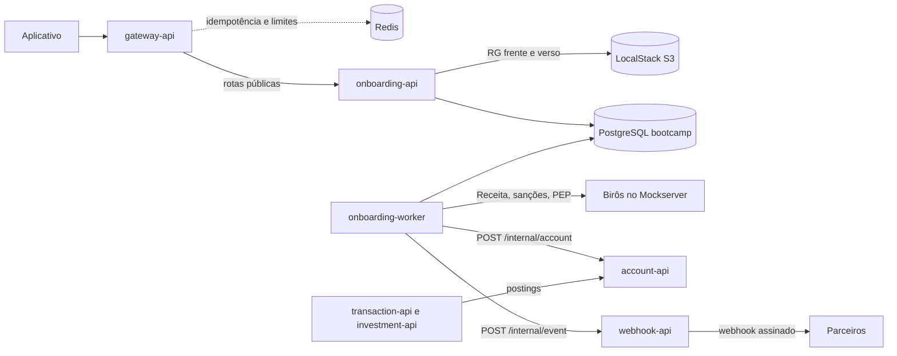

**A onboarding-api no ecossistema.**
- **Entrada:** tudo chega pelo **gateway-api**, que confere o token interno e a credencial JWT, guarda a `X-Idempotency-Key` no Redis por 24 horas, aplica os limites por origem e por credencial e corta pedidos longos demais.
- **Cliente e abertura juntos:** cliente, RG e abertura moram no banco único do grupo (`bootcamp`, seção 7 do `database/database.sql`), em tabelas separadas. Por isso cadastrar o cliente e começar a abertura é **um único `COMMIT`**, sem saga entre APIs. As fotos ficam num bucket S3 privado, emulado pelo LocalStack.
- **O onboarding-worker** é o mesmo código num processo separado. Olha a fila a cada segundo e analisa o KYC nos birôs, protegido por circuit breaker; a cada minuto, vence as aberturas paradas; e entrega os eventos da outbox à webhook-api. Podem rodar várias réplicas: o `FOR UPDATE SKIP LOCKED` faz cada abertura cair numa só.
- **Aprovação:** o worker pede a conta à account-api, que abre no máximo uma por cliente.
- **Depois da abertura:** a transaction-api e a investment-api nunca falam com a onboarding-api. Elas usam a `account_key` e a `customer_key` que vêm da credencial.

**Como as garantias são cumpridas.**
- **Ciclo de vida:** a abertura é uma máquina de estados com tabela de lookup e de eventos, como os outros quatro bancos. Cada mudança de etapa é gravada junto com o evento na outbox, num só `COMMIT`.
- **Idempotência em dois níveis:** quem faz o replay é o gateway. Quem garante que nada nasce em dobro, mesmo sem Redis, são os `UNIQUE` do banco.
- **Prazo:** cada abertura tem `expires_at`. Quem pede depois dele recebe `410`, e o worker apaga os dados de quem não terminou.

Alternativas descartadas:

- **Manter o cliente numa customer-api separada**: descartada porque a abertura chamaria outra API três vezes (cadastrar, guardar o RG e ler os dados para o KYC). Cada chamada seria um ponto de falha com estado pela metade, e CPF e renda viajariam entre APIs. Ganharia se o cliente tivesse vida própria além da abertura: atualização cadastral, várias contas por cliente ou outras jornadas, como crédito.
- **Aprovar quando o birô está fora (fail-open)**: descartada porque a consulta a sanções e PEP é obrigatória antes da aprovação, e aprovar sem ela é abrir conta sem saber para quem. Ganharia só em verificações opcionais, como enriquecer o cadastro.
- **Análise síncrona dentro do envio do RG**: descartada porque três birôs, com timeout de 2 s e retentativas, segurariam o pedido por até 20 s, e qualquer instabilidade viraria erro para a pessoa. Ganharia se os birôs respondessem sempre em milissegundos.
- **Cada API entregar os próprios webhooks, chamando o parceiro na mudança de etapa**: descartada porque cinco APIs repetiriam assinatura, retentativa e fila morta, e um processo que cai entre o `COMMIT` e a chamada perde o evento. A outbox guarda o evento no mesmo `COMMIT`, e a webhook-api entrega para todas. Ganharia se só uma API emitisse eventos e perder um aviso fosse aceitável.

## Implementação

### Rotas

| Método | Caminho | O que faz | Entrada (campos que importam) | Saídas (status e quando) |
|---|---|---|---|---|
| `GET` | `/` | Diz qual serviço é este | Aberta | `200` |
| `GET` | `/health_check` | Diz se o serviço está de pé | Aberta | `204` |
| `POST` | `/onboarding` | Cadastra o cliente e começa a abertura em `DRAFT`, num só `COMMIT`, e devolve a credencial. A abertura vence em 20 minutos. Repetir com a mesma chave não cria nada: o `UNIQUE(idempotency_key)` devolve a mesma abertura, com uma credencial nova. O gateway não guarda a resposta desta rota, porque ela traz uma credencial de 1 hora | Cabeçalho `X-Idempotency-Key`; `type` (`PF` ou `PJ`), `name`, `document_number` (CPF `000.000.000-00` na PF, CNPJ `00.000.000/0000-00` na PJ), `birth_date` na PF ou `opening_date` na PJ, `declared_monthly_income_cents`, `occupation` na PF, `pep_self_declared`; só o token interno | `201` com `onboarding_key`, `customer_key`, `status` `DRAFT`, `expires_at`, `access_token` (escopo `onboarding`, vale 1 hora) e `next_step` `SEND_DOCUMENT`; `200` com a mesma abertura, se a chave já tinha sido usada; `400 ONB000001` campo fora do formato; `400 ONB005001` campo obrigatório ausente; `400 ONB005002` PF menor de 18 anos; `409 ONB005003` documento já cadastrado; `422 ONB005004` CPF ou CNPJ com dígitos que não batem; `422 ONB005005` data que não existe ou no futuro; `429 ONB005013` tentativas demais para este documento ou desta origem |
| `PUT` | `/onboarding/{onboarding_key}/document` | Recebe as imagens do RG e guarda no bucket. Com o RG completo (frente e verso, ou uma imagem com os dois lados), a abertura vai para `PENDING_KYC` e entra na fila da análise. A abertura guarda no máximo duas imagens | Cabeçalho `X-Idempotency-Key`; `multipart/form-data` com `front`, `back` ou `both` (JPEG ou PNG, até 5 MB cada, conferidos aqui pelos primeiros bytes); credencial com escopo `onboarding` do dono da abertura | `202` com `status` `PENDING_KYC` e `next_step` `WAIT`, quando o RG ficou completo; `200` com `status` `DRAFT` e `next_step` `SEND_BACK` quando falta o verso, ou `SEND_FRONT` quando falta a frente; `400 ONB005001` nenhum arquivo; `401 ONB000003`, `401 ONB000006` ou `401 ONB000007` credencial ausente, inválida ou vencida; `404 ONB005006` abertura inexistente ou de outra pessoa; `409 ONB005008` a abertura não está em `DRAFT`; `409 ONB005009` o envio passaria de duas imagens, ou repete um lado já enviado; `410 ONB005010` a abertura venceu; `413 ONB005011` arquivo acima de 5 MB; `422 ONB005012` arquivo que não é JPEG nem PNG; `503 ONB005015` bucket sem resposta, e nada é gravado |
| `GET` | `/onboarding/{onboarding_key}` | Diz a etapa, o próximo passo, quanto falta para vencer, os lados do RG já recebidos, o resultado de cada verificação (sem os dados consultados), os motivos e o histórico | Credencial do dono da abertura ou com escopo `compliance` | `200` com `status`, `next_step`, `expires_at`, `documents` (cada imagem com `side`, `content_type`, `size_bytes` e `created_at`, nunca o caminho no bucket), `checks`, `reason_codes`, `risk_level`, `account_key` e `status_events` (cada evento com `status`, `reason_code`, `actor` e `event_datetime`; para compliance, também `justification` e `decided_by`); `401 ONB000003`, `ONB000006` ou `ONB000007`; `404 ONB005006`; `410 ONB005010` |
| `GET` | `/customer/{customer_key}` | Devolve o cadastro do cliente, sem a credencial | Credencial do próprio cliente ou com escopo `compliance` | `200` com `customer_key`, `type`, `name`, `document_number`, `birth_date` ou `opening_date` e `created_at`; `401 ONB000003`, `ONB000006` ou `ONB000007`; `404 ONB005007` cliente inexistente ou de outra pessoa |
| `GET` | `/onboardings` | Fila de compliance: lista as aberturas numa etapa, da mais antiga para a mais nova (pela criação da abertura). Com `reason_code`, só as que têm esse motivo entre os delas | `status` (uma etapa; padrão `MANUAL_REVIEW`), `reason_code` (opcional, um dos motivos da tabela abaixo), `limit` (padrão 10, de 1 a 100), `page` (padrão 0, a primeira); nenhum outro parâmetro; credencial com escopo `compliance` | `200` com `data`, `limit`, `page` e `is_last_page`; cada item com `onboarding_key`, `customer_key`, `status`, `reason_codes`, `risk_level` e `created_at`, nunca dado pessoal; `400 ONB000001` parâmetro fora do formato ou desconhecido; `401 ONB000003`, `ONB000006` ou `ONB000007`; `403 ONB000008` escopo insuficiente |
| `PUT` | `/onboarding/{onboarding_key}/decision` | Compliance decide uma abertura em `MANUAL_REVIEW`. Aprovar leva a `APPROVED`, e o worker abre a conta; recusar leva a `REJECTED`. A decisão, a justificativa e quem decidiu ficam no histórico | Cabeçalho `X-Idempotency-Key`; `decision` (`APPROVE` ou `REJECT`), `justification` (10 a 500 caracteres); credencial com escopo `compliance` | `202` com `onboarding_key`, `status` `APPROVED` e `next_step` `WAIT`; `200` com `status` `REJECTED`, `next_step` `NONE`, e `reason_codes` trocados por `COMPLIANCE_REJECTED`; `400 ONB005001` sem decisão ou sem justificativa; `400 ONB000001` decisão desconhecida ou justificativa fora do tamanho; `400 ONB000011` sem a chave idempotente; `401 ONB000003`, `ONB000006` ou `ONB000007`; `403 ONB000008`; `404 ONB005006`; `409 ONB005014` a abertura não está em `MANUAL_REVIEW`; `409 ONB005017` aprovação de abertura parada por birô fora, que precisa da retentativa em lote |
| `GET` | `/internal/onboarding/{onboarding_key}/document/{side}/url` | O link assinado de 5 minutos de uma imagem do RG, para compliance ver o documento (feito pelo Eduardo, resolve a pendência P1) | Credencial com escopo `compliance`; `side` é `front`, `back` ou `both` | `200` com `url`; `404 ONB005006` abertura inexistente, ou credencial que não é de compliance; `404 ONB005018` a abertura não tem esse lado |
| `POST` | `/admin/onboardings/retry` | Retentativa em lote: quando o birô voltou de uma instabilidade, devolve para a fila (`PENDING_KYC`) todas as aberturas que estão em `MANUAL_REVIEW` só porque o birô ficou fora. Antes, faz uma chamada de teste a cada birô obrigatório. Casos de PEP, renda ou divergência continuam com compliance. A contagem das 24 horas recomeça | Cabeçalho `X-Idempotency-Key`; `onboarding_keys` (opcional: uma lista com pelo menos uma chave; sem ela, ou sem corpo, vale para todas as aberturas com `BUREAU_UNAVAILABLE`); credencial com escopo `compliance` | `202` com `requeued_count` (zero se nenhuma da lista estava parada por birô fora); `400 ONB000001` corpo fora do formato; `400 ONB000011` sem a chave idempotente; `401 ONB000003`, `ONB000006` ou `ONB000007`; `403 ONB000008`; `503 ONB005016` algum birô obrigatório ainda não responde, e nada muda |

**O que o gateway-api faz antes (RFC 00).** Todas as rotas, menos `/` e `/health_check`, passam pelo gateway-api. Ele faz cinco coisas:

- **Token interno:** confere o `INTERNAL-TOKEN` (`403 QIT000002`).
- **Credencial:** confere a assinatura e o prazo do JWT.
- **Idempotência:** guarda a `X-Idempotency-Key` no Redis por 24 horas, com a resposta, e devolve essa resposta no replay. Chave ausente ou que não é UUID: `400 QIT000011`. Mesma chave com outro pedido: `409 QIT000012`. Mesma chave com o primeiro pedido ainda rodando: `409 QIT000013`, com `Retry-After: 1`.
- **Exceção, o `POST /onboarding`:** o gateway só reserva a chave enquanto o pedido roda (`409 QIT000013` para quem chega junto) e não guarda a resposta. A resposta traz uma credencial que vence em 1 hora, e guardá-la por 24 horas devolveria uma credencial vencida a quem repete o pedido para receber outra. A repetição segue para a onboarding-api, que devolve a mesma abertura com uma credencial nova (`200`) ou recusa outro pedido com a mesma chave (`409 ONB000012`).
- **Limites:** limita os pedidos por origem e por credencial (`429 QIT000014`).
- **Prazo do pedido:** corta pedidos que passam de 30 s, ou 60 s no envio do RG (`504 QIT000015`).

A onboarding-api recebe a chave repassada e a grava com `UNIQUE`. Assim, nada nasce em dobro se o Redis perder a chave ou se uma réplica do gateway cair no meio. No `POST /onboarding`, esse `UNIQUE` é quem responde a repetição.

**Credencial (OAuth 2.0, Bearer).** A onboarding-api, dona do cliente, emite o `access_token`: um JWT assinado com HMAC-SHA256 e a `AUTH_SECRET`, com estes campos:

- `sub`: a `customer_key`;
- `scope`: `onboarding` durante a abertura;
- `iat` e `exp`: vale 1 hora;
- `jti`.

Gateway e API conferem a credencial. O operador de compliance usa uma credencial do mesmo formato, com estes campos:

- `sub`: quem é o analista, por exemplo `compliance:ana.oliveira`; é o que fica no histórico como quem decidiu;
- `scope`: `compliance`;
- `iat`, `exp` (1 hora) e `jti`, como a do cliente.

Ela é assinada com a mesma `AUTH_SECRET` e emitida fora desta API, porque o login de funcionário está fora do escopo. Nos testes e na demonstração, um script gera a credencial. Uma senha fixa, como o `OPERATOR_TOKEN`, foi descartada: não diria quem decidiu e nunca venceria.

As recusas seguem o padrão OAuth, com o cabeçalho `WWW-Authenticate`:

| Situação | Resposta | Cabeçalho `WWW-Authenticate` |
|---|---|---|
| Sem credencial | `401 ONB000003` | `Bearer realm="banco"` |
| Assinatura ou formato inválidos | `401 ONB000006` | `error="invalid_token"` |
| Credencial vencida | `401 ONB000007` | `error="invalid_token"` e `error_description="token expirado"` |
| Escopo insuficiente | `403 ONB000008` | `error="insufficient_scope"` e `scope="compliance"` |

**Prazo de 20 minutos.** Cada abertura nasce com `expires_at` 20 minutos depois do `POST` (`ONBOARDING_TIMEOUT_MINUTES`). Enquanto está em `DRAFT`:

- Qualquer pedido depois do prazo recebe `410 ONB005010`, mesmo antes de o worker passar. A API não grava nada nesse pedido: quem marca `EXPIRED` e apaga é só o worker, num lugar só, sem disputa com a API.
- A cada minuto, o worker vence as que passaram do prazo. Apaga as fotos do bucket, pelo prefixo da abertura (`rg/{onboarding_key}/`), e os dados pessoais do cadastro: sem conta aberta, não há relação com o banco que justifique guardá-los. A linha da abertura fica como `EXPIRED`, sem dado pessoal.
- O dono continua recebendo `410`, e não `404`, depois que o cadastro some: a abertura guarda a `customer_key`, que é um UUID e não identifica ninguém, e é por ela que a API reconhece a credencial do dono. Para qualquer outra pessoa, continua `404` (R8).
- O documento fica livre para uma nova abertura.

Depois que o RG fica completo, o prazo deixa de valer: a análise é tempo do banco, e não da pessoa.

**Limites de pedidos na onboarding-api.** O gateway-api limita por origem e por credencial. Os limites que dependem do corpo do pedido ficam aqui, no Redis, em janela fixa:

| Limite | Valor padrão | Chave no Redis | Ao estourar |
|---|---|---|---|
| Aberturas por documento | 5 por hora | `rl:document:{sha256 do documento}`, nunca o CPF puro | `429 ONB005013`, com `Retry-After` |
| Recusas por origem, contra quem testa CPFs para descobrir clientes | 20 em 10 minutos bloqueiam a origem por 30 minutos | `rl:refusal:{ip informado pelo gateway}` | `429 ONB005013` |

Se o Redis cair, esses limites ficam desligados e o problema é registrado no log. A aprovação continua dependendo do KYC. Nos testes, `X-Test-Client-Ip` simula a origem, mas só vale com `RATE_LIMIT_TEST_MODE=true`.

**Log sem dado pessoal.** O log de cada pedido mostra o método, o caminho e os nomes dos parâmetros da URL. O valor só aparece nos parâmetros que a API conhece e não são pessoais (`limit`, `page`, `status` e `reason_code`); qualquer outro vira `***`. Assim, um CPF mandado por engano na URL, que a API recusa com `400 ONB000001`, também não fica no log. O access log do uvicorn fica desligado, porque ele grava a URL inteira, e o log da própria API já registra a entrada e a saída de cada pedido, com o status e o tempo. Duas proteções valem para toda linha de log, da API e do worker, inclusive as do uvicorn, que passam pelo mesmo caminho:

- **CPF e CNPJ são mascarados:** com ou sem pontuação, viram `***`, venham de onde vierem. Um documento posto por engano no caminho da URL (`GET /customer/{documento}`), por exemplo, recebe `404` e não fica no log.
- **A mensagem de um erro do banco nunca vai para o log.** Quando uma restrição barra uma gravação, o PostgreSQL repete na mensagem a linha que tentou gravar, com nome, documento e data de nascimento, e o SQLAlchemy acrescenta os valores do comando. No lugar dela, o log mostra o tipo do erro, o SQLSTATE, a tabela, a restrição que barrou e o caminho no código: o bastante para achar o defeito, sem guardar dado de ninguém.

**Formato de erro.** Todo erro tem `code`, `title`, `description`, `translation` (em português), `request_id` (o protocolo, para o atendimento) e `errors`, uma lista com `field`, `rule` e `message`:

- `400 ONB005001` lista cada campo ausente, com `rule` `required`;
- `400 ONB000001` lista o campo e a regra de formato (`format`, `type`, `minimum` ou `maximum`);
- `400 ONB005002` traz `rule` `minimum_age`;
- os `422` trazem `cpf_check_digit`, `cnpj_check_digit` ou `valid_date`.

Nenhuma mensagem traz CPF, renda ou documento.

**Testes.** Cada código, cada motivo e cada fluxo desta RFC têm um teste black box escrito antes do código. A account-api, a webhook-api, a Receita e as listas ficam no Mockserver, e o bucket no LocalStack.

**Prefixo dos códigos.** Todo erro que a onboarding-api responde começa com `ONB`: os gerais usam os números da RFC 00 (`ONB000001` formato, `ONB000002` token interno, `ONB000003`, `ONB000006`, `ONB000007` e `ONB000008` credencial, `ONB000011` e `ONB000012` chave idempotente, `ONB000404` rota inexistente, `ONB000500` erro inesperado) e os desta API ficam em `ONB005xxx`. Os que só o gateway responde continuam `QIT` (`QIT000013`, `QIT000014` e `QIT000015`), porque são de outra API.

| Código | Status | Quando |
|---|---|---|
| `ONB005001` | 400 | Dado obrigatório ausente, inclusive nenhum arquivo no envio do RG (cada campo em `errors`) |
| `ONB005002` | 400 | PF menor de 18 anos |
| `ONB005003` | 409 | CPF ou CNPJ já cadastrado |
| `ONB005004` | 422 | CPF ou CNPJ com dígitos verificadores que não batem |
| `ONB005005` | 422 | Data que não existe ou no futuro |
| `ONB005006` | 404 | Abertura inexistente ou de outra pessoa |
| `ONB005007` | 404 | Cliente inexistente ou de outra pessoa |
| `ONB005008` | 409 | A abertura não está em `DRAFT`, e não espera mais documento |
| `ONB005009` | 409 | O envio passaria de duas imagens do RG, ou repete um lado já enviado |
| `ONB005010` | 410 | A abertura venceu (20 minutos); comece outra |
| `ONB005011` | 413 | Arquivo acima de 5 MB |
| `ONB005012` | 422 | Arquivo que não é JPEG nem PNG |
| `ONB005013` | 429 | Tentativas demais para este documento ou desta origem; espere o `Retry-After` |
| `ONB005014` | 409 | A abertura não está em `MANUAL_REVIEW` |
| `ONB005015` | 503 | Bucket sem resposta; repita com a mesma chave |
| `ONB005016` | 503 | Na retentativa em lote, algum birô obrigatório ainda não responde |
| `ONB005017` | 409 | Compliance tentou aprovar uma abertura parada por birô fora: sem as consultas obrigatórias, não há aprovação; use a retentativa em lote |
| `ONB005018` | 404 | No link assinado do RG, a abertura não tem o lado pedido |

Motivos de recusa e de revisão, em `reason_codes`. Não são erros HTTP: são o resultado da análise.

| Motivo | Etapa | Quando |
|---|---|---|
| `RECEITA_SUSPENSA`, `RECEITA_CANCELADA`, `RECEITA_TITULAR_FALECIDO`, `RECEITA_NULA`, `RECEITA_PENDENTE_REGULARIZACAO` | `REJECTED` | Situação do CPF diferente de regular |
| `RECEITA_CNPJ_SUSPENSA`, `RECEITA_CNPJ_INAPTA`, `RECEITA_CNPJ_BAIXADA`, `RECEITA_CNPJ_NULA` | `REJECTED` | Situação do CNPJ diferente de ativa |
| `RECEITA_NAO_ENCONTRADO` | `REJECTED` | A Receita não conhece o documento |
| `RECEITA_DADOS_DIVERGENTES` | `MANUAL_REVIEW` | Nome ou data não batem com a Receita |
| `SANCTIONS_MATCH` | `REJECTED` | Nome ou documento numa lista de sanções. A comunicação ao Coaf é registrada |
| `PEP_MATCH`, `PEP_SELF_DECLARED` | `MANUAL_REVIEW` | Pessoa exposta politicamente, pela lista ou por declaração própria; exige diligência reforçada e decisão humana |
| `INCOME_PROFILE` | `MANUAL_REVIEW` | Renda declarada que não combina com o perfil |
| `BUREAU_UNAVAILABLE` | `MANUAL_REVIEW` | Um birô obrigatório ficou 24 horas sem responder; a retentativa em lote devolve para a fila |
| `COMPLIANCE_REJECTED` | `REJECTED` | Decisão humana de recusar. Substitui os motivos da revisão |

Contratos com as vizinhas, para conferir dos dois lados:

| Vizinha | Quem chama | Contrato | Quando | O que garante |
|---|---|---|---|---|
| gateway-api | o gateway chama a onboarding | Todas as rotas públicas acima, com `X-Idempotency-Key` repassada | Sempre | Replay em 24 horas, menos no `POST /onboarding`, que só reserva a chave enquanto roda; `UNIQUE` aqui como garantia final |
| LocalStack S3 | onboarding-api | `PutObject`, `DeleteObjects` pelo prefixo da abertura e link assinado de 5 minutos no bucket privado `rg-documentos` | Envio do RG e vencimento | Primeiro o bucket, depois o `COMMIT`: nunca uma linha sem foto |
| Receita, sanções e PEP | onboarding-worker; na chamada de teste, a onboarding-api | Consulta por documento, timeout 2 s, 2 retentativas, circuit breaker; chamada de teste `GET .../health` | Análise; retentativa em lote | Nenhuma aprovação sem as três |
| account-api | onboarding-worker | `POST /internal/account` com `customer_key`, `X-Idempotency-Key` igual à `onboarding_key` (RFC 02) | Depois de `APPROVED` | `201` conta nova ou `200` a que já existia: uma conta por cliente |
| webhook-api | onboarding-worker | `POST /internal/event` com `event_id`, `event_type`, `occurred_at` e `data`, sem dado pessoal, e o `SERVICE-TOKEN` no cabeçalho; timeout de 3 s; `202` recebido ou `200` já recebido (contrato a alinhar com a RFC 06, que propõe uma tabela compartilhada `webhook_outbox`) | Cada evento da outbox | O mesmo `event_id` duas vezes é recebido uma vez; os eventos de uma abertura chegam na ordem em que aconteceram |
| transaction-api e investment-api | não chamam a onboarding | Usam a `customer_key` e a `account_key` | Depois de `ACTIVE` | A onboarding não está no caminho do dinheiro |

Cenários de erro e tratamento:

| Cenário | Resposta | O que o sistema faz | O que a pessoa faz |
|---|---|---|---|
| Falta um campo obrigatório | `400 ONB005001`, com os campos | Nada é gravado | Completa e reenvia |
| Campo fora do formato | `400 ONB000001`, com campo e regra | Nada é gravado | Corrige e reenvia |
| Menor de 18 anos | `400 ONB005002` | Nada é gravado | Nenhuma: não pode abrir conta |
| CPF ou CNPJ com dígito errado, ou data impossível | `422`, com a regra | Nada é gravado | Corrige e reenvia |
| Documento que já é cliente | `409 ONB005003` | Nada é gravado; conta como recusa da origem | Usa a conta que já tem |
| Chave ausente, repetida com outro pedido ou ainda em processamento | `400 QIT000011`, `409 QIT000012` ou `409 QIT000013` (gateway) | Nada muda | Gera um UUID, ou espera um segundo e repete |
| Pedidos demais | `429 QIT000014` (gateway) ou `429 ONB005013` | Recusa sem processar | Espera o `Retry-After` |
| Pedido longo demais | `504 QIT000015` (gateway) | O gateway libera a conexão; a abertura fica na etapa em que estava | Repete com a mesma chave |
| Credencial ausente, inválida ou vencida | `401 ONB000003`, `ONB000006` ou `ONB000007` | Nada é consultado | Repete o `POST /onboarding` com a mesma chave para receber outra credencial |
| Cliente tenta decidir, ver a fila ou retentar | `403 ONB000008` | Nada muda | Nenhuma |
| Compliance tenta aprovar uma abertura parada por birô fora | `409 ONB005017` | Nada muda | Usa a retentativa em lote quando o birô voltar, ou recusa |
| Abertura ou cadastro de outra pessoa | `404 ONB005006` ou `ONB005007` | Nada é revelado | Nenhuma |
| RG sem nenhum arquivo | `400 ONB005001` | Nada é enviado ao bucket | Anexa a frente e o verso |
| Terceira imagem, ou um lado repetido | `409 ONB005009` | Nada é enviado ao bucket | Nenhuma: o RG já está completo |
| RG enviado fora de `DRAFT` | `409 ONB005008` | Nada muda | Consulta a etapa |
| Arquivo grande ou de outro tipo | `413 ONB005011` ou `422 ONB005012` | Nada é enviado | Manda JPEG ou PNG de até 5 MB |
| Bucket fora do ar | `503 ONB005015` | Nada é gravado; a abertura continua em `DRAFT` | Repete com a mesma chave, dentro do prazo |
| Passaram os 20 minutos | `410 ONB005010` | Nada é gravado no pedido; em até 1 minuto, o worker vence a abertura e apaga os dados pessoais e as fotos | Começa outra abertura |
| Birô fora na análise | `GET` mostra `ANALYSIS` | Tenta de novo na hora, até 2 vezes; depois agenda outra tentativa em 1, 5, 15 ou 60 minutos, sem gravar nada da análise. Com 5 falhas seguidas, o circuito do birô abre por 30 s | Espera |
| Birô fora por 24 horas | `MANUAL_REVIEW`, `BUREAU_UNAVAILABLE` | Evento `account.kyc.manual_review` | Espera; compliance retenta em lote quando o birô voltar |
| Retentativa com o birô ainda fora | `503 ONB005016` | Nenhuma abertura muda | Compliance tenta mais tarde |
| CPF suspenso, cancelado, nulo ou de titular falecido | `REJECTED`, `RECEITA_*` | Evento `account.rejected` | Regulariza na Receita e começa outra abertura |
| Nome numa lista de sanções | `REJECTED`, `SANCTIONS_MATCH` | Comunicação registrada; evento `account.rejected` | Nenhuma pelo aplicativo |
| PEP ou renda incompatível | `MANUAL_REVIEW` | Entra na fila de compliance | Espera a decisão |
| account-api fora depois da aprovação | `GET` mostra `APPROVED` | O worker tenta abrir a conta de novo | Espera |
| webhook-api fora | Nenhuma para a pessoa | O evento fica na outbox e é reenviado com espera crescente | Nenhuma |
| Redis fora | Respostas normais | Replay pelo `UNIQUE` do banco, limites desligados, circuit breaker por processo | Nenhuma |

### Banco de Dados (Somente diagrama)

**Diagrama A: o cliente**

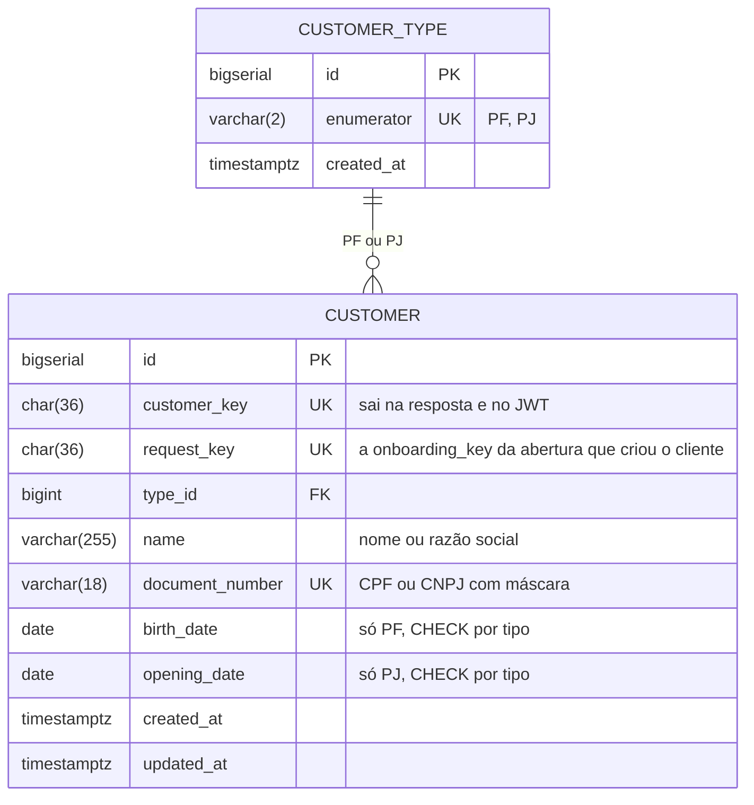

**Diagrama B: a abertura, o RG e o histórico**

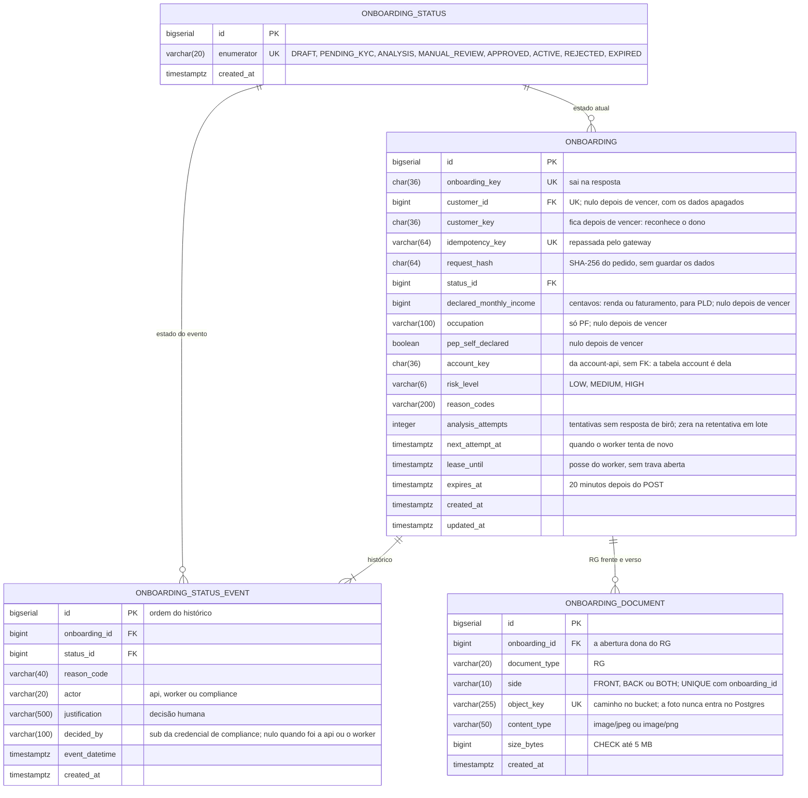

**Diagrama C: a análise e os eventos**

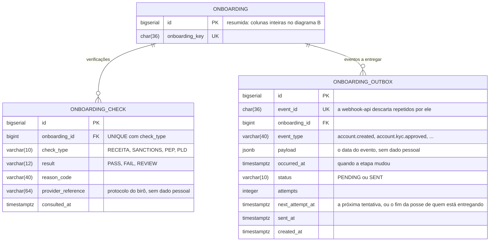

### Fluxos

**Ponta a ponta: da abertura à conta ativa**

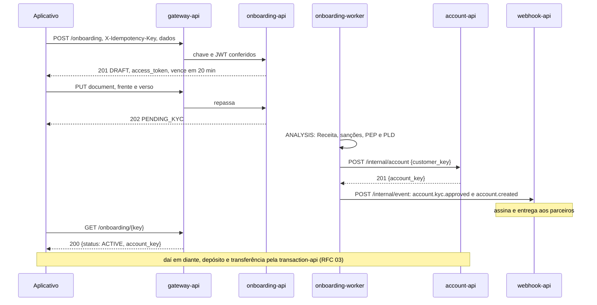

1. A pessoa manda os dados. O gateway confere a chave e a credencial. A onboarding-api confere CPF e idade e grava o cliente e a abertura juntos.
2. A pessoa manda o RG. A foto vai para o bucket, e a abertura entra na fila da análise. A parte da pessoa termina aqui, dentro dos 20 minutos.
3. O worker consulta os birôs e aplica as regras. Com tudo certo, pede a conta à account-api e grava cada passo com o evento na outbox.
4. A webhook-api recebe os eventos e avisa os parceiros. O aplicativo também pode consultar a etapa.
5. Com a conta ativa, a pessoa passa a usar a transaction-api e a investment-api, que nunca falam com a onboarding-api.

**O ciclo de vida da abertura, para qualquer pessoa entender**

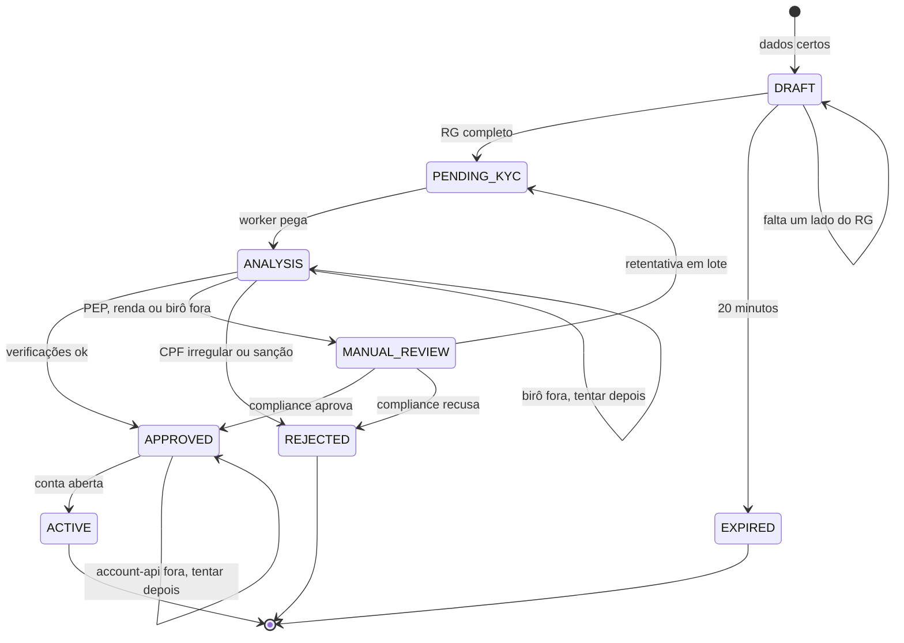

1. **Rascunho (`DRAFT`):** os dados estão certos e o cadastro existe. Falta o RG, e o relógio de 20 minutos está correndo. Se vencer, a abertura fica **vencida (`EXPIRED`)** e os dados são apagados.
2. **Na fila (`PENDING_KYC`):** o RG está completo, e a abertura espera o worker.
3. **Em análise (`ANALYSIS`):** o banco consulta a Receita, as sanções e o PEP, e compara a renda com o perfil.
4. **Aprovada (`APPROVED`)**, depois **ativa (`ACTIVE`):** tudo certo; o banco abre a conta.
5. **Análise humana (`MANUAL_REVIEW`):** PEP, renda incompatível, dados divergentes ou birô fora por 24 horas. Compliance aprova, recusa ou, no caso do birô, manda de volta para a fila.
6. **Recusada (`REJECTED`):** CPF irregular, sanção ou decisão humana.

**Começar a abertura: caminho feliz e falhas**

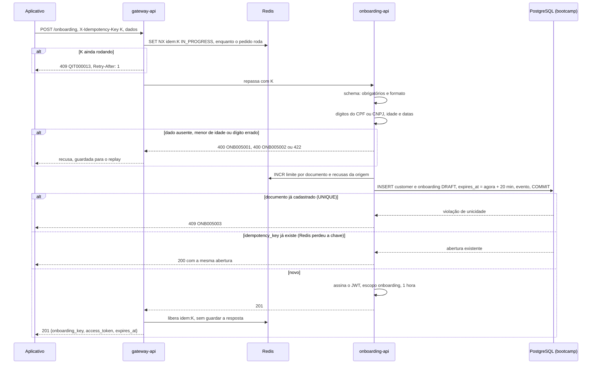

1. O gateway reserva a chave no Redis só enquanto o pedido roda. Repetição com o primeiro ainda rodando recebe `409 QIT000013`. Depois, a repetição chega à onboarding-api, que devolve a mesma abertura com uma credencial nova.
2. O schema confere obrigatórios (`400 ONB005001`, com cada campo) e formato (`400 ONB000001`).
3. **Os números do documento são conferidos aqui, na hora:** os dígitos verificadores do CPF ou CNPJ, com `422 ONB005004` se não batem. A idade mínima de 18 anos dá `400 ONB005002`. A situação na Receita só é consultada depois, pelo worker.
4. Cliente, abertura e o primeiro evento entram num **único `COMMIT`**. O `UNIQUE(document_number)` segura dois cadastros do mesmo CPF chegando juntos, e o perdedor recebe `409 ONB005003`, nunca `500`. O `UNIQUE(idempotency_key)` segura a repetição mesmo sem Redis.
5. A credencial é emitida e não é guardada: a assinatura prova que veio daqui.

**Mandar o RG, frente e verso: caminho feliz e falhas**

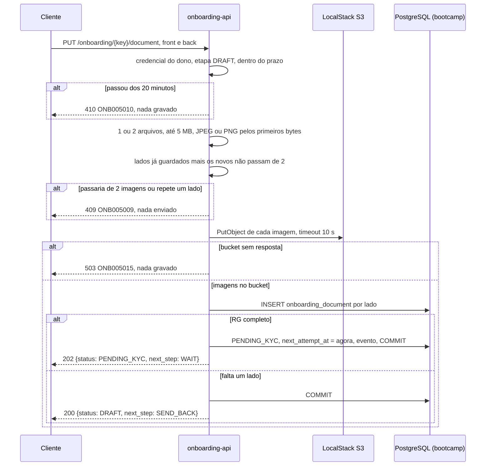

1. Confere a credencial e a etapa, nesta ordem: de outra pessoa, `404 ONB005006`; vencida, `410 ONB005010`; fora de `DRAFT`, `409 ONB005008`.
2. Confere os arquivos antes de gastar o bucket. Nenhum: `400 ONB005001`. Acima de 5 MB: `413 ONB005011`. Nem JPEG nem PNG: `422 ONB005012`. Somados aos já guardados, mais de dois, ou um lado repetido: `409 ONB005009`.
3. **O RG completo** é frente e verso, em duas imagens, ou uma imagem `both` com os dois lados.
4. Primeiro o bucket, depois o banco. O pior caso é um objeto sem linha, invisível, e nunca uma linha apontando para uma foto que não existe. Nenhuma trava fica aberta durante o `PutObject`: depois do bucket, a API trava a abertura (`SELECT ... FOR UPDATE`) e confere de novo a etapa e os lados, já vendo o que outro envio gravou. Assim a frente e o verso chegando juntos completam o RG, e a frente e uma imagem `both` juntas não passam as duas. O `UNIQUE(onboarding_id, side)` é a última garantia.

**Analisar o KYC no worker: caminho feliz e falhas**

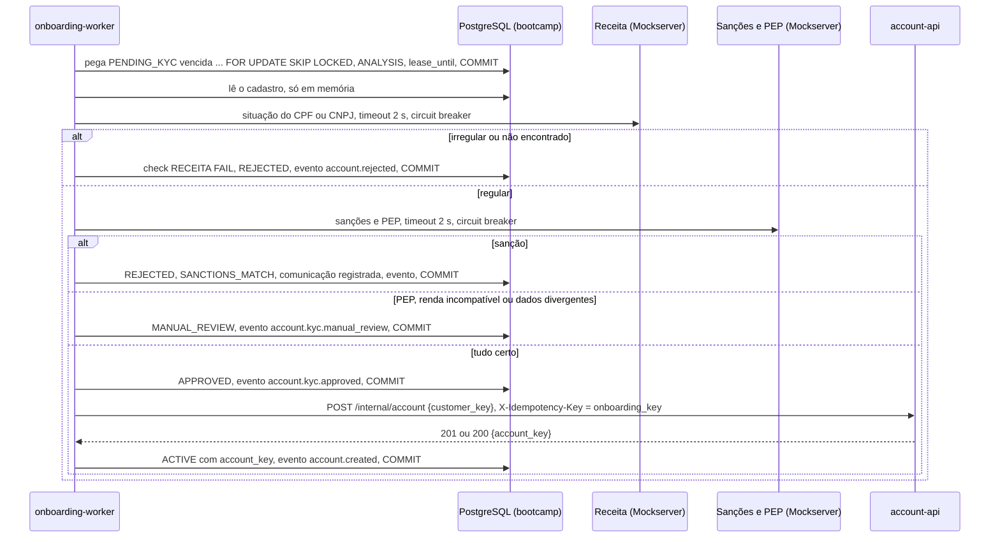

1. **Toma posse** de uma abertura da fila com `FOR UPDATE SKIP LOCKED`, marca `ANALYSIS` e o prazo de posse, num `COMMIT` curto. Nenhuma trava fica aberta durante os birôs. Se o worker morrer, o prazo vence e outra réplica continua.
2. **Lê o cadastro no próprio banco**, sem chamar outra API. CPF e renda não saem do banco, a não ser para a consulta ao birô.
3. **Consulta, nesta ordem: Receita, sanções e PEP.** Nenhuma aprovação acontece sem as três. Uma recusa da Receita encerra a análise antes das listas, e uma sanção encerra antes do PEP: depois de uma recusa, ninguém mais recebe o documento. Um birô sem resposta também encerra a análise ali, sem gravar nada dela: a abertura continua em `ANALYSIS` e tenta tudo de novo depois (veja "Birô fora do ar"). Nome ou data diferentes dos da Receita não encerram: a análise segue, e a abertura vai para revisão. Cada resultado vira uma linha em `onboarding_check`, sem os dados consultados. PEP pela lista dá `PEP_MATCH`; declarado pela pessoa e fora da lista, `PEP_SELF_DECLARED`.
4. **Aplica as regras de PLD** e calcula o nível de risco:
   - `LOW`: nenhuma regra disparou;
   - `MEDIUM`: uma regra de renda disparou;
   - `HIGH`: é PEP, ou duas regras ou mais dispararam.
5. **Com a aprovação, abre a conta.** A account-api abre no máximo uma por cliente; a `onboarding_key` vai como chave idempotente, com `customer_key` e `type` no corpo e o `SERVICE-TOKEN` no cabeçalho. Se ela não responde, ou responde fora de `200` e `201`, a abertura fica `APPROVED`, e o worker tenta de novo depois de 1 minuto, com a mesma chave.

Contrato dos birôs, simulados no Mockserver com o mesmo formato (decisão D1 do plano de testes). Todos recebem um `POST` com JSON e respondem `200`; o documento vai só no corpo, nunca no endereço.

| Birô | Rota | Pedido | Resposta |
|---|---|---|---|
| Receita | `POST /receita/v1/consulta` | `document_number` | `situacao`, `name`, `birth_date` (PF) ou `opening_date` (PJ) e `protocol` |
| Sanções | `POST /sancoes/v1/consulta` | `document_number`, `name` | `match` (`true` ou `false`) e `protocol` |
| PEP | `POST /pep/v1/consulta` | `document_number`; na PJ, o CNPJ (decisão D14) | `pep` (`true` ou `false`) e `protocol` |
| Os três, chamada de teste | `GET /receita/v1/health`, `GET /sancoes/v1/health` e `GET /pep/v1/health` | nada | `200` quando o birô está de pé. Só a retentativa em lote chama |

`situacao` no CPF: `REGULAR`, `SUSPENSA`, `CANCELADA`, `TITULAR_FALECIDO`, `NULA`, `PENDENTE_REGULARIZACAO`. No CNPJ: `ATIVA`, `SUSPENSA`, `INAPTA`, `BAIXADA`, `NULA`. Para os dois: `NAO_ENCONTRADO`. Uma resposta fora do contrato (status diferente de `200`, corpo que não é JSON, ou sem o campo principal: `situacao`, `match` ou `pep`) conta como birô sem resposta: na dúvida, não aprova nem recusa.

O próximo passo (`next_step`) depois do RG completo é `WAIT` enquanto o banco trabalha (`PENDING_KYC`, `ANALYSIS`, `MANUAL_REVIEW` e `APPROVED`), e `NONE` quando a abertura terminou (`ACTIVE` e `REJECTED`).

Regras de PLD. Os valores são de exemplo, configuráveis e devem ser definidos pela área de compliance.

| Regra | Quando dispara | Resultado |
|---|---|---|
| Renda incompatível com a idade | PF com menos de 21 anos e renda acima de R$ 30.000 por mês | `MANUAL_REVIEW`, `INCOME_PROFILE` |
| Renda fora do padrão | PF com renda acima de R$ 500.000 por mês | `MANUAL_REVIEW`, `INCOME_PROFILE` |
| Empresa nova com faturamento alto | PJ aberta há menos de 180 dias e faturamento acima de R$ 300.000 por mês | `MANUAL_REVIEW`, `INCOME_PROFILE` |
| PEP | Na lista (mantida pela CGU e disponibilizada no Siscoaf), ou declarado pela própria pessoa; a condição dura 5 anos depois de deixar o cargo | `MANUAL_REVIEW`, `PEP_MATCH` ou `PEP_SELF_DECLARED` |

**Birô fora do ar: circuit breaker e retentativa em lote**

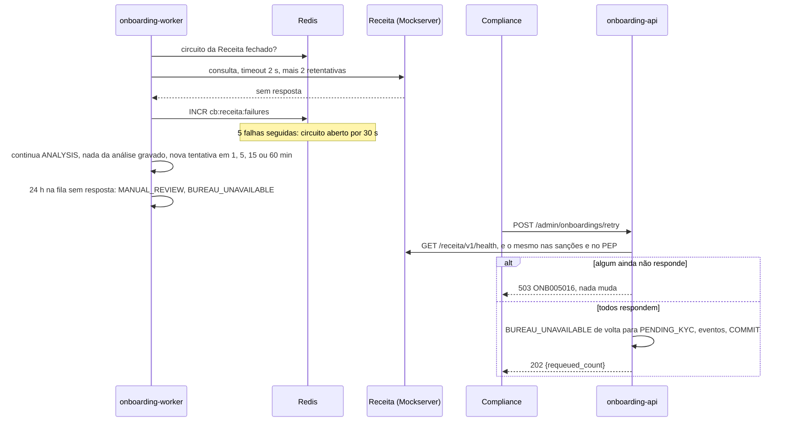

1. **Cada consulta** tem 2 s de prazo. Se dá timeout, conexão recusada ou `5xx`, o worker repete na hora, até 2 vezes. Uma resposta fora do contrato não é repetida: repetir não muda a resposta.
2. **Sem resposta, a análise para ali.** Nada dela é gravado: nem verificação, nem motivo, nem nível de risco. A abertura continua em `ANALYSIS`, com o próximo passo `WAIT`, e a nova tentativa refaz tudo, da Receita em diante.
3. **A contagem das 24 horas** começa quando a abertura entra na fila: no RG completo ou na retentativa em lote. Passadas 24 horas, a próxima tentativa sem resposta leva a abertura a `MANUAL_REVIEW`, com `BUREAU_UNAVAILABLE`, sem aprovar nem recusar.
4. **O circuito** é de cada birô, e não de cada abertura. Ele conta consultas, e não chamadas: uma consulta que, com as 2 retentativas, ficou sem resposta é uma falha. Uma resposta dentro do contrato zera a contagem e fecha o circuito.
5. **A retentativa em lote** faz uma chamada de teste a cada birô (`GET .../health`, uma só, com 2 s de prazo, fora do circuito). Se todos respondem `200`, devolve à fila, no mesmo `COMMIT`, as aberturas com `BUREAU_UNAVAILABLE` e só esse motivo, cada uma com o evento e quem pediu (`compliance`).

| Parâmetro | Valor | Por quê |
|---|---|---|
| Timeout por chamada | 2 s | Um birô lento não prende o worker |
| Retentativas na mesma tentativa | 2, com 200 ms e 400 ms de espera mais uma variação aleatória de até metade da espera | Cobre um soluço de rede sem martelar o birô |
| O que conta como falha | Uma consulta que, depois das 2 retentativas, ainda deu timeout, conexão recusada ou `5xx` | `4xx` e resposta sem o campo do contrato não abrem nem fecham o circuito: o birô respondeu, mas a resposta não diz nada. Para a abertura, são birô sem resposta. "Documento não encontrado" (`NAO_ENCONTRADO`) é resposta do contrato |
| Quando o circuito abre | 5 falhas seguidas | Para de insistir num birô que caiu |
| Tempo aberto | 30 s; depois, meio aberto: a próxima consulta passa como teste, e as outras esperam; se ela tem resposta, o circuito fecha, e se falha, abre por mais 30 s | Volta sozinho quando o birô volta |
| Nova tentativa da abertura | 1, 5, 15 e 60 minutos, depois de hora em hora | A abertura espera, sem gastar chamadas |
| Limite de espera | 24 horas desde que a abertura entrou na fila (RG completo ou retentativa em lote) levam a `MANUAL_REVIEW`, com `BUREAU_UNAVAILABLE` | Na dúvida, não aprova nem recusa sozinho |
| Retentativa em lote | `POST /admin/onboardings/retry` testa cada birô e devolve à fila só as aberturas com `BUREAU_UNAVAILABLE`, recomeçando a contagem das 24 horas | Uma instabilidade de minutos não vira trabalho manual, caso a caso |
| Onde fica o estado | No Redis (`cb:{birô}:failures`, `cb:{birô}:open` e `cb:{birô}:trial`), compartilhado entre as réplicas; sem Redis, cada processo guarda o seu | As réplicas param juntas de chamar o birô caído |

Uma regra por taxa de falha (por exemplo, 50% em 10 chamadas) foi descartada nesta versão: com três birôs de baixo volume, as 5 falhas seguidas já cobrem o birô que cai, e a regra por taxa não tem teste black box barato (decisão D27 do plano de testes).

**Revisão manual por compliance**

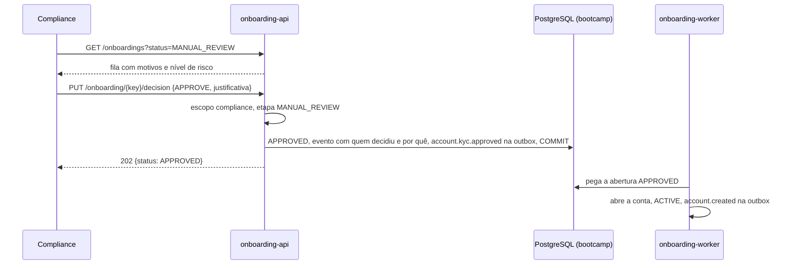

1. A fila mostra os motivos e o nível de risco, nunca dado pessoal, da abertura mais antiga para a mais nova. Para ver o documento, compliance pede o link assinado do RG, e cada acesso fica registrado.
2. A decisão exige justificativa, que fica no histórico com quem decidiu (o `sub` da credencial, em `decided_by`). Só compliance vê a justificativa e quem decidiu: o cliente vê a etapa e o motivo. Avisar o cliente de uma suspeita de lavagem é proibido pela regra de PLD, e a justificativa pode falar dela. Sanção nunca chega aqui: é recusa automática.
3. A decisão trava a abertura (`SELECT ... FOR UPDATE`) antes de conferir a etapa: duas decisões juntas valem uma vez, e a outra recebe `409 ONB005014`. Decidir uma abertura fora de `MANUAL_REVIEW` também responde `409 ONB005014`.
4. Recusar troca os motivos por `COMPLIANCE_REJECTED`. Aprovar mantém os motivos e o nível de risco que levaram à revisão.
5. Uma abertura parada por birô fora (`BUREAU_UNAVAILABLE`) não pode ser aprovada: as consultas obrigatórias nunca terminaram, e aprovar seria abrir conta sem KYC. Compliance usa a retentativa em lote quando o birô voltar, ou recusa. Aprovar responde `409 ONB005017`.
6. A retentativa em lote também grava quem pediu, em `decided_by`.

**Eventos: da outbox à webhook-api**

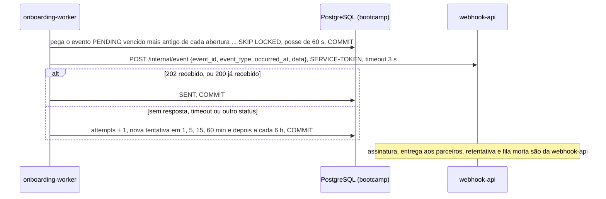

| Evento | Quando | Conteúdo, sem dado pessoal |
|---|---|---|
| `account.kyc.approved` | Entrada em `APPROVED` | `onboarding_key`, `customer_key`, `risk_level` |
| `account.created` | Entrada em `ACTIVE` | `onboarding_key`, `customer_key`, `account_key` |
| `account.rejected` | Entrada em `REJECTED` | `onboarding_key`, `reason_codes` |
| `account.kyc.manual_review` | Entrada em `MANUAL_REVIEW` | `onboarding_key`, `reason_codes` |

1. **Grava junto:** o evento entra na outbox no mesmo `COMMIT` da mudança de etapa, pelo `change_status` do repositório, por onde toda mudança de etapa passa. Se a etapa mudou, o evento existe; se não mudou, não existe. `DRAFT`, `PENDING_KYC`, `ANALYSIS` e `EXPIRED` não publicam nada.
2. **Entrega só à webhook-api:** a onboarding-api não fala com parceiros. O worker, a cada segundo, pega um evento por vez, marca a posse por 60 s (`next_attempt_at`), dá `COMMIT` e só então chama: nenhuma trava fica aberta durante a chamada. Se o worker cair no meio, a posse vence, e outra réplica entrega de novo, com o mesmo `event_id`.
3. **O envelope:** `{"event_id": UUID, "event_type": ..., "occurred_at": ISO 8601, "data": {...}}`, com o `SERVICE-TOKEN` no cabeçalho. `data` tem só os campos da tabela acima.
4. **Entregue é `202` ou `200`.** Qualquer outra resposta, timeout de 3 s ou conexão recusada é falha: o evento continua `PENDING`, e a próxima tentativa vem em 1, 5, 15 e 60 minutos e depois a cada 6 horas, com o mesmo `event_id`.
5. **Na ordem, por abertura:** um evento só sai depois de os anteriores da mesma abertura terem saído. Assim, `account.created` nunca chega antes de `account.kyc.approved`, mesmo que o primeiro falhe e espere a nova tentativa. Aberturas diferentes não esperam umas pelas outras.
6. **Do parceiro cuida a webhook-api:** assinatura, retentativa, fila morta e cadastro de destinos valem igual para todas as APIs. A RFC 06 (webhook-api) propõe outro caminho, uma tabela compartilhada `webhook_outbox` que a webhook-api lê direto. Até o time alinhar, a onboarding segue esta seção; se a RFC 06 vencer, muda só a entrega (o item 2), e a gravação junto com a etapa continua.

**Prazo de 20 minutos: a abertura vence**

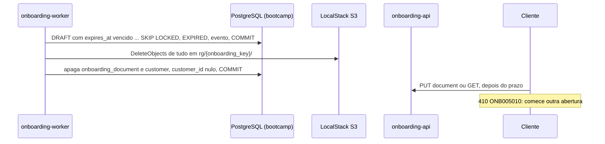

1. A cada minuto, o worker pega as aberturas em `DRAFT` com `expires_at` vencido, e as `EXPIRED` que ainda têm cadastro. Anda das mais antigas para as mais novas, em lotes, e cada lote começa depois do último: a passada sempre termina, e uma abertura que falha não segura as que vêm depois.
2. Marca `EXPIRED` com o evento, num `COMMIT` curto: um envio do RG que chegue no meio encontra a abertura vencida e recebe `410`. Depois apaga as fotos pelo prefixo da abertura, sem trava aberta, inclusive alguma que subiu num envio recusado e nunca ganhou linha. Por fim, num `COMMIT`, apaga o cadastro e as linhas de documento. A abertura fica como `EXPIRED`, sem dado pessoal. Se o bucket falhar, ela fica `EXPIRED` com o cadastro, e a próxima passada tenta de novo.
3. Um pedido que chega depois do prazo, antes da passada do worker, já recebe `410 ONB005010`, sem gravar nada.
4. Os pedidos também têm prazo: o gateway corta o que passa de 30 s (60 s no envio do RG), e nada fica preso consumindo recurso.

**Clique duplo: o mesmo pedido chega duas vezes**

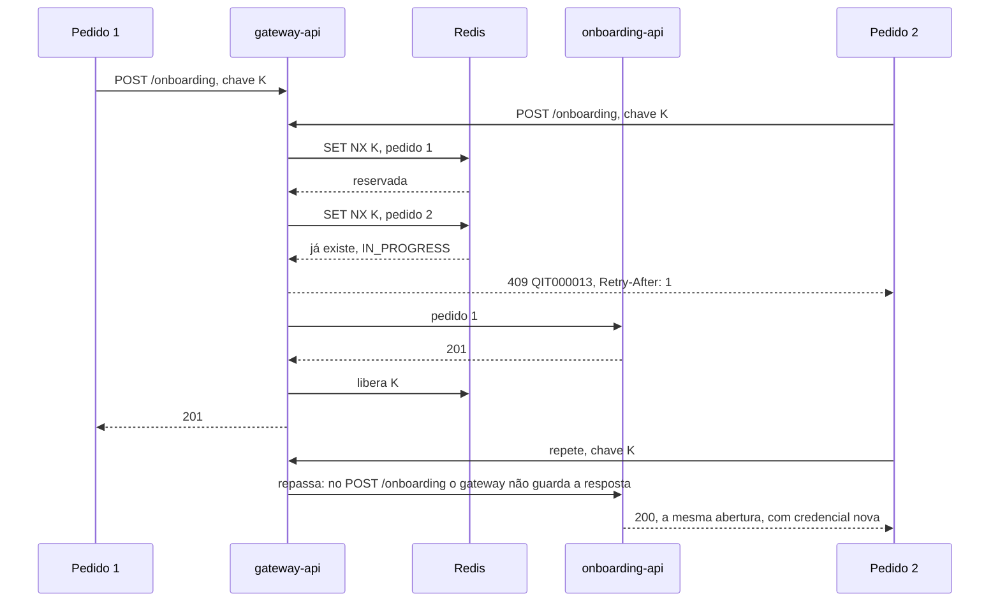

1. O gateway deixa um pedido só seguir. O outro recebe `409 QIT000013` e, ao repetir, recebe da onboarding-api a mesma abertura, com uma credencial nova (`200`).
2. **Sem Redis**, a garantia continua por outros caminhos:
   - **No `POST`:** o `UNIQUE(idempotency_key)` faz o segundo pedido esperar o `COMMIT` do primeiro e receber a mesma abertura, com `200`.
   - **No envio do RG:** o `UNIQUE(onboarding_id, side)` impede o mesmo lado duas vezes.
3. Em nenhum caso nasce cliente, abertura ou conta em dobro.

> ## Principal desafio
>
> - **Qual é:** abrir a conta só depois do KYC obrigatório e da checagem de PLD, com birôs externos que podem cair. A abertura pode ser abandonada no meio, cair ou chegar duas vezes, e mesmo assim nunca pode criar cliente ou conta em dobro, aprovar sem verificar, guardar dado de quem desistiu nem vazar dado pessoal.
> - **Por que é difícil:** a abertura passa pelo bucket, pelos birôs, pela account-api e pela webhook-api, e não existe um `COMMIT` que valha para todos. Esperar os birôs dentro do pedido prende a pessoa a eles. Aprovar quando eles caem quebra a obrigação de consultar. Avisar os parceiros fora da transação perde ou inventa eventos. E aberturas abandonadas acumulam dados pessoais sem motivo.
> - **Como o desenho resolve:**
>   - Cliente, RG e abertura moram no mesmo banco, e começar a abertura é um único `COMMIT`.
>   - A análise roda no worker, com prazo de posse e sem trava aberta, protegida por circuit breaker. Na dúvida, não aprova: espera, passa a decisão a uma pessoa e, quando o birô volta, retenta em lote.
>   - Cada mudança de etapa grava o evento na outbox no mesmo `COMMIT`, e a webhook-api entrega.
>   - O gateway faz o replay das chaves, e os `UNIQUE` garantem o resto.
>   - O prazo de 20 minutos apaga o que foi abandonado.

## Histórico de versões

- **0.14 (08/10):** log sem dado pessoal em toda linha: CPF e CNPJ, com ou sem pontuação, viram `***`, inclusive no caminho da URL; a mensagem de um erro do banco não vai para o log, só o tipo, o SQLSTATE, a tabela e a restrição; o log do uvicorn passa pelo mesmo caminho (decisão D35). O histórico de versões passou para o fim.
- **0.13 (07/10):** log sem dado pessoal: o log de cada pedido mostra o caminho e os nomes dos parâmetros, e o valor só dos que não são pessoais; sem o access log do uvicorn (D34).
- **0.12 (07/10):** eventos: o envelope e os cabeçalhos do `POST /internal/event`, a ordem dos eventos de uma abertura, a posse de 60 s na entrega e o `occurred_at` na outbox; o contrato com a webhook-api ainda se alinha com a RFC 06 (D33).
- **0.11 (07/10):** compliance: campos e ordem da fila, quem decidiu no histórico, visível só a compliance, recusa que troca os motivos por `COMPLIANCE_REJECTED` e aprovação de abertura parada por birô fora recusada com `ONB005017` (D30 a D32).
- **0.10 (07/10):** birô fora do ar: o que conta como falha, circuito aberto só por 5 falhas seguidas, análise interrompida sem nada gravado, 24 horas contadas da entrada na fila, chamada de teste dos birôs e corpo da retentativa em lote (D15 e D27 a D29).
- **0.9 (07/10):** análise do KYC: contrato dos birôs, `next_step` depois do RG, fila do worker a cada segundo e sanção que encerra a análise antes do PEP (D1, D2, D14 e D26).
- **0.8 (07/10):** prazo de 20 minutos: a abertura guarda a `customer_key`, e o dono recebe `410` mesmo depois de o worker apagar o cadastro; quem marca `EXPIRED` e apaga é só o worker; as fotos saem pelo prefixo da abertura (D24 e D25).
- **0.7 (07/10):** envio do RG: `SEND_FRONT` quando só o verso chegou, formato de `documents` no `GET` e trava da abertura no envio (D22 e D23).
- **0.6 (06/10):** o gateway não guarda a resposta do `POST /onboarding`; credencial de compliance definida; todo erro da onboarding-api com prefixo `ONB`; tabelas no banco único do grupo, com renda, ocupação e PEP na abertura; o RG em `onboarding_document`, ligado à abertura.
- **0.5 (05/10):** absorve a customer-api; idempotência no gateway-api; eventos pela webhook-api; prazo de 20 minutos; retentativa em lote.
